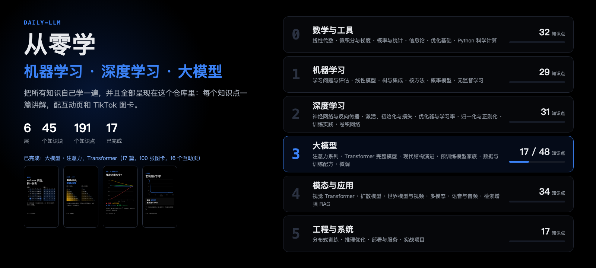
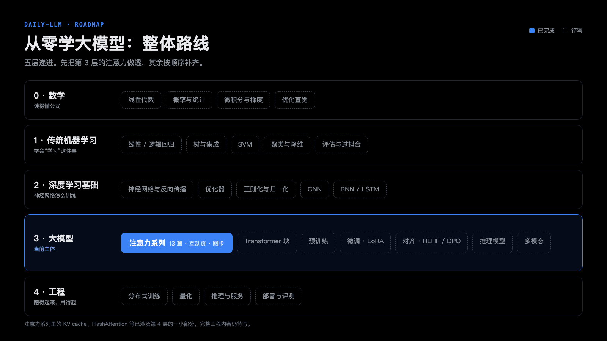

<div align="center">



# Daily-LLM：从零学机器学习、深度学习与大模型

### 把所有知识自己学一遍，全部呈现在这里

<p>
  <a href="#framework"><strong>完整大纲</strong></a>
  ·
  <a href="#done"><strong>已完成部分</strong></a>
  ·
  <a href="https://zkywsg.github.io/Daily-LLM/"><strong>在线读 / 玩</strong></a>
  ·
  <a href="#start"><strong>本地运行</strong></a>
  ·
  <a href="#archive"><strong>旧版归档</strong></a>
</p>

[](LICENSE)

</div>

---

## 这个项目做什么

目标只有一个：**从零开始，把机器学习、深度学习、大模型的全部知识系统地学一遍，并把学的过程完整呈现在这个仓库里。**

整个仓库按一个大框架组织：6 层、45 个知识块、191 个知识点，从数学与工具一路到大模型和工程系统（完整大纲在下面）。每个知识点计划产出三样东西，来自同一份源：

- **讲解**：本仓库的 Markdown，GitHub 上直接读，公式可渲染，不依赖任何托管。
- **互动页**：浏览器里拖一拖、点一点，数字在页面里实时算。
- **图卡**：TikTok 竖版图文（1080×1920），用于分享。

**目前进度：191 个知识点里已完成 17 个**，都在“大模型”层：注意力系列（13 篇）和 Transformer 完整模型（4 篇）。其余按大纲顺序逐步补齐；每一项的状态和旧版素材位置都记录在 [learn/roadmap.json](learn/roadmap.json)。

> 例子都是教学用的**玩具模型**：注意力系列的权重是人工设定的；迷你 GPT 是真的训练出来的，但只有 2.75 万个参数、语料由规则生成。注意力系列里真实模型的脚本（`attn-08`）写好了但**没在真实模型上运行过**；文献与配置对照摘要或公开资料核对，来源写在每篇末尾。

<a id="framework"></a>

## 完整大纲



<!-- ROADMAP:START -->
### 0 · 数学与工具

读得懂公式，写得出代码。共 7 个知识块、32 个知识点，已完成 0。

| 知识块 | 包含的知识点 | 状态 |
|---|---|---|
| **线性代数** | 向量与矩阵运算、线性变换与几何直觉、特征值与特征分解、SVD 与低秩近似、范数、内积与相似度 | 待写 |
| **微积分与梯度** | 导数与链式法则、偏导、梯度、Jacobian、Hessian、泰勒展开、自动微分原理 | 待写 |
| **概率与统计** | 随机变量与常见分布、期望、方差、协方差、贝叶斯公式、最大似然与 MAP、置信区间与假设检验、大数定律与中心极限定理 | 待写 |
| **信息论** | 熵、交叉熵、KL 散度、互信息、困惑度 | 待写 |
| **优化基础** | 凸与非凸、梯度下降、牛顿法、拉格朗日与约束优化、随机优化直觉 | 待写 |
| **Python 科学计算** | NumPy 向量化、Matplotlib 画图、Jupyter 工作流 | 待写 |
| **PyTorch 入门** | 张量与广播、autograd、nn.Module 与训练循环、GPU 与调试 | 待写 |

### 1 · 机器学习

学会“学习”这件事。共 7 个知识块、29 个知识点，已完成 0。

| 知识块 | 包含的知识点 | 状态 |
|---|---|---|
| **学习问题与评估** | 监督 / 无监督 / 强化学习、偏差与方差、过拟合与正则化、交叉验证与数据划分、分类与回归指标（精召 F1 AUC）、数据泄漏与类别不均衡、特征工程 | 待写 |
| **线性模型** | 线性回归、逻辑回归、Softmax 回归、L1 / L2 正则 | 待写 |
| **树与集成** | 决策树、Bagging 与随机森林、AdaBoost、GBDT / XGBoost | 待写 |
| **核方法** | SVM 与间隔、核技巧 | 待写 |
| **概率模型** | 朴素贝叶斯、高斯混合与 EM、隐马尔可夫模型、概率图模型入门 | 待写 |
| **无监督学习** | K-means、层次聚类与 DBSCAN、PCA、t-SNE 与 UMAP | 待写 |
| **强化学习基础** | MDP 与价值函数、Q-learning、策略梯度、Actor-Critic 与 PPO | 待写 |

### 2 · 深度学习

神经网络怎么训练、怎么设计。共 9 个知识块、31 个知识点，已完成 0。

| 知识块 | 包含的知识点 | 状态 |
|---|---|---|
| **神经网络与反向传播** | 感知机与 MLP、反向传播推导、万能近似与深度的意义 | 待写 |
| **激活、初始化与损失** | ReLU / GELU / SwiGLU、Xavier 与 He 初始化、MSE、交叉熵、对比损失 | 待写 |
| **优化器与学习率** | SGD 与动量、Adam / AdamW、学习率调度与 warmup、梯度裁剪 | 待写 |
| **归一化与正则化** | BatchNorm / LayerNorm / RMSNorm、Dropout 与权重衰减、早停与数据增强 | 待写 |
| **训练实践** | 混合精度、梯度消失与爆炸排查、过拟合小批量测试、实验记录与复现 | 待写 |
| **卷积网络** | 卷积与池化、LeNet / AlexNet / VGG、Inception 与 ResNet、EfficientNet 与 ConvNeXt | 待写 |
| **循环网络** | RNN 与梯度问题、LSTM / GRU、seq2seq、注意力的起点（接注意力系列） | 待写 |
| **表示学习** | word2vec / GloVe、分词：BPE、WordPiece、SentencePiece、自编码器与 VAE、对比学习 | 待写 |
| **生成式基础** | GAN 原理与训练难点、DCGAN / CycleGAN / StyleGAN | 待写 |

### 3 · 大模型

Transformer 主线：结构 → 预训练 → 对齐 → 推理。共 9 个知识块、48 个知识点，已完成 17。

| 知识块 | 包含的知识点 | 状态 |
|---|---|---|
| [**注意力系列**](learn/3-llm/01-attention/) | 动机、基础 A：q/k/v 与加权求和、基础 B：多头、基础 C：掩码与位置、手算一遍、矩阵与形状、softmax 与 √d 梯度推导、多头的内部、位置编码：正弦 / RoPE / ALiBi、从零实现、真实模型里的注意力、高效注意力：KV cache / GQA / FlashAttention、综合自测与小项目 | 已完成 |
| [**Transformer 完整模型**](learn/3-llm/tf-01-block/) | 残差与 Pre/Post-LN、FFN 与 SwiGLU、Encoder / Decoder / Decoder-only、从零训练迷你 GPT | 已完成 |
| **现代结构演进** | MoE 稀疏专家、MLA 与 GQA、长上下文与位置外推、状态空间模型与 Mamba、线性注意力 | 待写 |
| **预训练模型家族** | BERT / RoBERTa、GPT-1/2/3、T5 与统一文本到文本、Scaling Laws 与 Chinchilla | 待写 |
| **数据与训练配方** | 数据采集、清洗、去重、分词词表设计、批量、学习率与训练稳定性、数据配比与课程学习、合成数据 | 待写 |
| **微调** | SFT 指令微调、Adapter / Prefix、LoRA / QLoRA、知识蒸馏 | 待写 |
| **对齐** | 奖励模型、RLHF 与 PPO、DPO 及变体、Constitutional AI 与 RLAIF、奖励黑客 | 待写 |
| **推理模型** | 思维链 CoT、自一致与搜索、o1 与测试时计算、DeepSeek-R1 与 GRPO | 待写 |
| **评测与安全** | 基准与污染、LLM-as-judge、幻觉、越狱与安全对齐 | 待写 |

### 4 · 模态与应用

把模型用到更多地方。共 9 个知识块、34 个知识点，已完成 0。

| 知识块 | 包含的知识点 | 状态 |
|---|---|---|
| **视觉 Transformer** | ViT、DeiT、Swin、DiT | 待写 |
| **扩散模型** | DDPM、潜空间扩散、条件生成与引导、Flow Matching、少步蒸馏 | 待写 |
| **世界模型与视频** | World Models、视频扩散、Sora、Genie / GameNGen | 待写 |
| **多模态** | CLIP、BLIP / Flamingo、LLaVA | 待写 |
| **语音与音频** | wav2vec 2.0 / HuBERT、Whisper、AudioLM / MusicGen | 待写 |
| **检索增强 RAG** | 向量检索、分块与重排、RAG 评测 | 待写 |
| **Agent 与工具** | ReAct、Toolformer 与函数调用、记忆与规划、多智能体 | 待写 |
| **图神经网络** | GCN、GraphSAGE、GAT、GIN 与 Graphormer | 待写 |
| **推荐系统** | Wide&Deep、YouTube DNN、DeepFM、DIN 与 PinSage | 待写 |

### 5 · 工程与系统

跑得起来、用得起。共 4 个知识块、17 个知识点，已完成 0。

| 知识块 | 包含的知识点 | 状态 |
|---|---|---|
| **分布式训练** | 数据并行、ZeRO 与 FSDP、张量并行、流水线并行、检查点与容错 | 待写 |
| **推理优化** | KV cache（已有）、量化：INT8 / AWQ / GPTQ、投机解码、连续批处理与 PagedAttention、剪枝与蒸馏 | 部分覆盖（KV cache、GQA、FlashAttention 已在注意力系列） |
| **部署与服务** | vLLM 与推理服务、延迟与吞吐、成本估算、观测与护栏 | 待写 |
| **实战项目** | 从零训练小 GPT、企业 RAG 系统、微调到部署流水线 | 待写 |

<!-- ROADMAP:END -->

<a id="done"></a>

## 已完成：大模型层（17 篇）

### Transformer 完整模型（4 篇）

| 篇 | 内容 | 互动页 |
|---|---|---|
| T01 | [残差与 LayerNorm：为什么能叠几十层](learn/3-llm/tf-01-block/) | 有 |
| T02 | [FFN 与 SwiGLU：参数大头在哪](learn/3-llm/tf-02-ffn/) | 有 |
| T03 | [Encoder、Decoder 与三种架构](learn/3-llm/tf-03-architectures/) | 有 |
| T04 | [从零训练迷你 GPT（NumPy，手写反向传播）](learn/3-llm/tf-04-mini-gpt/) | 浏览器里可续写 |

### 注意力系列（13 篇）

| 篇 | 内容 | 互动页 |
|---|---|---|
| 基础 A | [注意力基础：q/k/v、打分、加权求和](learn/3-llm/01-attention/) | 有 |
| 基础 B | [多头：并行的多套规则](learn/3-llm/02-multihead/) | 有 |
| 基础 C | [掩码与位置](learn/3-llm/03-mask-position/) | 有 |
| 00 | [动机：为什么发明注意力](learn/3-llm/attn-01-motivation/) | 有 |
| 02 | [手算一遍](learn/3-llm/attn-02-hand-calc/) | 有 |
| 03 | [矩阵与形状](learn/3-llm/attn-03-shapes/) | 有 |
| 04 | [softmax 与 √d：梯度推导](learn/3-llm/attn-04-softmax-scale/) | 有 |
| 05 | [多头的内部：头分解与消融](learn/3-llm/attn-05-multihead-deep/) | 有 |
| 06 | [位置编码：正弦、RoPE、ALiBi](learn/3-llm/attn-06-position/) | 有 |
| 07 | [从零实现（NumPy，7 个测试）](learn/3-llm/attn-07-from-scratch/) | — |
| 08 | [真实模型里的注意力（脚本未在真实模型上运行）](learn/3-llm/attn-08-real-model/) | 查看器 |
| 09 | [高效注意力：KV cache、GQA、FlashAttention](learn/3-llm/attn-09-efficient/) | 有 |
| 10 | [综合自测与小项目（27 题）](learn/3-llm/attn-10-selftest/) | 有 |

> 文献与模型配置已对照摘要或公开资料核对，来源写在各篇末尾。示例模型都是教学用的玩具模型，不是训练出来的。

学习顺序与进度见 [learn/README.md](learn/README.md)；完整大纲的单页版见 [learn/ROADMAP.md](learn/ROADMAP.md)。

<a id="start"></a>

## 本地运行

**只想读**：直接看上面的链接，或打开 <https://zkywsg.github.io/Daily-LLM/>。

**离线整页预览**（需要 Node 20+）：

```bash
cd learn && npm ci && cd ..
node learn/build-preview.mjs      # 生成 learn/preview.html，双击打开
node learn/build-site.mjs         # 生成 learn/_site/，与线上站点一致
node learn/build-roadmap.mjs      # 改了 roadmap.json 后，重新生成路线图和大纲
node learn/build-banner.mjs       # 重新生成顶部横幅
```

**跑代码**：`attn-07` 的从零实现和 `tf-04` 的迷你 GPT 只需 `numpy`（`pip install numpy`）；`attn-08` 的两个脚本需要 `torch` 与 `transformers`，未在真实模型上运行过。互动页是纯前端，也可以直接双击 `learn/3-llm/<知识点>/demo/index.html`。

<a id="archive"></a>

## 旧版归档

早期按“19 个架构家族”写的时间线内容（1986–2025）已于 2026-11-26 整体移入 [`_archive/v1/`](_archive/v1/)，只读，不再更新。其中不少内容会作为新大纲对应知识块的取材来源（见 roadmap.json 的 `old` 字段），写新版时重写。更早的素材在 [`_archive/`](_archive/README.md) 下。

<details>
<summary>旧版 19 个家族目录</summary>

| # | 家族 | 关键年份 | 一句话定位 |
|---|------|---------|-----------|
| 01 | [CNN 卷积神经网络](_archive/v1/01-cnn/) | 2012– | 把视觉特征从手工设计交给反向传播 |
| 02 | [RNN / LSTM / GRU](_archive/v1/02-rnn-lstm/) | 1997, 2014– | 给神经网络装上"记忆" |
| 03 | [Word Embedding](_archive/v1/03-word-embedding/) | 2013– | 让"词"有了分布式的语义坐标 |
| 04 | [GAN](_archive/v1/04-gan/) | 2014– | 用对抗博弈学会"生成" |
| 05 | [Transformer](_archive/v1/05-transformer/) | 2017 | 用纯注意力替代循环，彻底并行 |
| 06 | [BERT 系预训练](_archive/v1/06-bert-family/) | 2018– | 双向预训练 + 微调成为 NLP 新范式 |
| 07 | [GPT 系 + Scaling](_archive/v1/07-gpt-scaling/) | 2018–2020 | 把规模做到底，涌现 Few-shot |
| 08 | [视觉 Transformer (ViT)](_archive/v1/08-vit/) | 2020– | Transformer 反攻视觉 |
| 09 | [多模态对齐](_archive/v1/09-multimodal-clip/) | 2021– | 让"图"和"文"住进同一个空间 |
| 10 | [扩散模型](_archive/v1/10-diffusion/) | 2020– | 生成的新王，从噪声到图像 |
| 11 | [PEFT / LoRA](_archive/v1/11-peft-lora/) | 2021– | 把大模型微调成本压到普通人能玩 |
| 12 | [对齐与 RLHF](_archive/v1/12-rlhf-alignment/) | 2022– | 把"会答"变成"答得好" |
| 13 | [MoE 与高效推理](_archive/v1/13-moe-efficient/) | 2023– | 大模型在不变贵的前提下变更大 |
| 14 | [RAG 与 Agent](_archive/v1/14-rag-agent/) | 2023– | 把模型接上外部世界 |
| 15 | [推理模型 (o1/R1)](_archive/v1/15-reasoning-o1-r1/) | 2024– | 推理时多想几步，能力再上一个台阶 |
| 16 | [世界模型 / 视频生成](_archive/v1/16-world-models/) | 2018– | 学习环境动态，从想象训练走向可交互视频世界 |
| 17 | [图神经网络](_archive/v1/17-graph-neural-networks/) | 2017– | 把深度学习扩展到任意图结构 |
| 18 | [语音 / 音频模型](_archive/v1/18-speech-audio/) | 2020– | 从自监督语音表征走向音频 token 生成 |
| 19 | [推荐系统](_archive/v1/19-recommendation/) | 2016– | 从特征记忆走向兴趣注意力与图表征学习 |

按年份速查：[TIMELINE.md](_archive/v1/TIMELINE.md) · 横切基础：[foundations/](_archive/v1/foundations/) · 英文版：[README_EN.md](_archive/v1/README_EN.md)

</details>

---

## 贡献与许可

欢迎指出错误、补充内容。提交前请先阅读 [CONTRIBUTING.md](CONTRIBUTING.md)（部分约定针对旧版结构，以 `learn/` 现状为准）。

本项目采用 [MIT License](LICENSE)。
