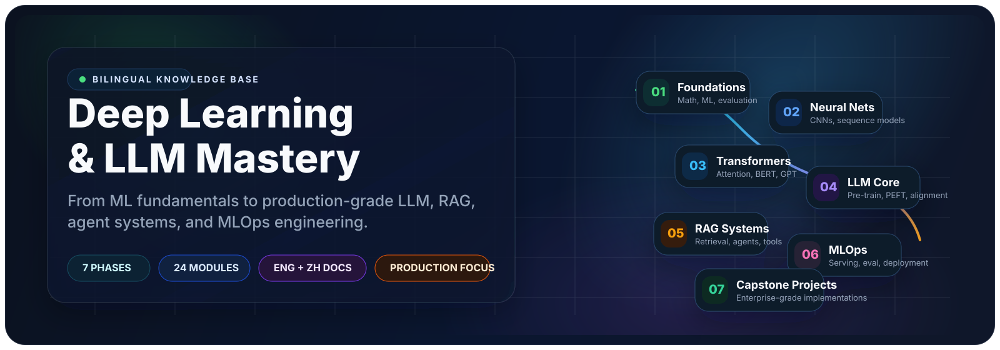
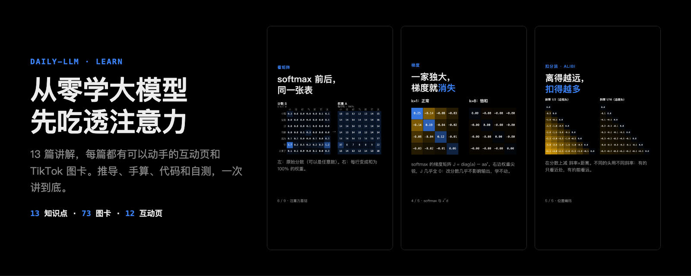

<div align="center">



# 深度学习与大模型精通之路

### Deep Learning & LLM Mastery

<p>
  深度学习与大模型的可视化学习路线 —— 从 1986 年 RNN 到 2025 年推理模型，按 19 个架构家族梳理演进脉络。
</p>

<p>
  <a href="README_EN.md"><strong>English</strong></a>
  ·
  <a href="#learn"><strong>从零学</strong></a>
  ·
  <a href="#timeline"><strong>时间线</strong></a>
  ·
  <a href="#web-timeline"><strong>可视化网页</strong></a>
  ·
  <a href="#modules"><strong>模块索引</strong></a>
  ·
  <a href="#quick-start"><strong>快速开始</strong></a>
  ·
  <a href="CONTRIBUTING.md"><strong>贡献指南</strong></a>
</p>

[](LICENSE)
[](https://www.python.org/downloads/)
[](./)
[](README_EN.md)

</div>

---

<a id="learn"></a>

## 从零学：注意力系列



先把大模型的核心部件**注意力**吃透。每个知识点按五层写：一句话 → 白话 → 手算 → 数学推导 → 代码与练习，并配可以动手的互动页和 TikTok 竖版图卡。

- **在线读 / 玩**：<https://zkywsg.github.io/Daily-LLM/>（启用 GitHub Pages 后可用；没启用时按下面的方法本地打开）
- **本地打开**：`cd web && npm ci && cd .. && node learn/build-preview.mjs`，然后打开 `learn/preview.html`（离线可看）
- **学习顺序与进度**：[learn/README.md](learn/README.md)

| 篇 | 内容 | 互动页 |
|---|---|---|
| 基础 A | [注意力基础：q/k/v、打分、加权求和](learn/3-llm/01-attention/) | 有 |
| 基础 B | [多头：并行的多套规则](learn/3-llm/02-multihead/) | 有 |
| 基础 C | [掩码与位置](learn/3-llm/03-mask-position/) | 有 |
| 00 | [动机：为什么发明注意力](learn/3-llm/attn-01-motivation/) | 有 |
| 02 | [手算一遍](learn/3-llm/attn-02-hand-calc/) | 有 |
| 03 | [矩阵与形状](learn/3-llm/attn-03-shapes/) | 有 |
| 04 | [softmax 与 √d：梯度推导](learn/3-llm/attn-04-softmax-scale/) | 有 |
| 05 | [多头的内部：头分解与消融](learn/3-llm/attn-05-multihead-deep/) | 有 |
| 06 | [位置编码：正弦、RoPE、ALiBi](learn/3-llm/attn-06-position/) | 有 |
| 07 | [从零实现（NumPy，7 个测试）](learn/3-llm/attn-07-from-scratch/) | — |
| 08 | [真实模型里的注意力（脚本未在真实模型上运行）](learn/3-llm/attn-08-real-model/) | 查看器 |
| 09 | [高效注意力：KV cache、GQA、FlashAttention](learn/3-llm/attn-09-efficient/) | 有 |
| 10 | [综合自测与小项目（27 题）](learn/3-llm/attn-10-selftest/) | 有 |

> 文献与模型配置已对照摘要或公开资料核对，来源写在各篇末尾。示例模型都是教学用的玩具模型，不是训练出来的。

---

<a id="timeline"></a>

## 时间线：19 个家族（1986–2025）

| # | 家族 | 关键年份 | 一句话定位 |
|---|------|---------|-----------|
| 01 | [CNN 卷积神经网络](01-cnn/) | 2012– | 把视觉特征从手工设计交给反向传播 |
| 02 | [RNN / LSTM / GRU](02-rnn-lstm/) | 1997, 2014– | 给神经网络装上"记忆" |
| 03 | [Word Embedding](03-word-embedding/) | 2013– | 让"词"有了分布式的语义坐标 |
| 04 | [GAN](04-gan/) | 2014– | 用对抗博弈学会"生成" |
| 05 | [Transformer](05-transformer/) | 2017 | 用纯注意力替代循环，彻底并行 |
| 06 | [BERT 系预训练](06-bert-family/) | 2018– | 双向预训练 + 微调成为 NLP 新范式 |
| 07 | [GPT 系 + Scaling](07-gpt-scaling/) | 2018–2020 | 把规模做到底，涌现 Few-shot |
| 08 | [视觉 Transformer (ViT)](08-vit/) | 2020– | Transformer 反攻视觉 |
| 09 | [多模态对齐](09-multimodal-clip/) | 2021– | 让"图"和"文"住进同一个空间 |
| 10 | [扩散模型](10-diffusion/) | 2020– | 生成的新王，从噪声到图像 |
| 11 | [PEFT / LoRA](11-peft-lora/) | 2021– | 把大模型微调成本压到普通人能玩 |
| 12 | [对齐与 RLHF](12-rlhf-alignment/) | 2022– | 把"会答"变成"答得好" |
| 13 | [MoE 与高效推理](13-moe-efficient/) | 2023– | 大模型在不变贵的前提下变更大 |
| 14 | [RAG 与 Agent](14-rag-agent/) | 2023– | 把模型接上外部世界 |
| 15 | [推理模型 (o1/R1)](15-reasoning-o1-r1/) | 2024– | 推理时多想几步，能力再上一个台阶 |
| 16 | [世界模型 / 视频生成](16-world-models/) | 2018– | 学习环境动态，从想象训练走向可交互视频世界 |
| 17 | [图神经网络](17-graph-neural-networks/) | 2017– | 把深度学习扩展到任意图结构 |
| 18 | [语音 / 音频模型](18-speech-audio/) | 2020– | 从自监督语音表征走向音频 token 生成 |
| 19 | [推荐系统](19-recommendation/) | 2016– | 从特征记忆走向兴趣注意力与图表征学习 |

> 按年份速查：[TIMELINE.md](TIMELINE.md)（自动生成）
> 横切基础：[foundations/](foundations/)

---

<a id="web-timeline"></a>

## 可视化网页

仓库内已提供一个独立的时间线可视化网页，入口在 [web/](web/)。

本地运行：

```bash
cd web
npm install
npm run dev
```

页面提供按时间与按家族两种浏览方式，节点页结合 Markdown 正文与交互式金标本。当前先作为本地网页维护，公网部署后再补充正式访问地址。

---

<a id="modules"></a>

## 仓库结构

- `01-cnn/` … `19-recommendation/` — 19 个架构/范式家族
- `foundations/` — 横切基础（激活、反传、优化器、归一化、注意力机制…）
- `projects/` — 跨家族实战项目
- `web/` — 可视化网页
- `TIMELINE.md` — 自动生成的按年份索引
- `_archive/` — 旧 `timeline/` 与 `tracks/` 内容，作为家族内容重写时的素材源

---

<a id="quick-start"></a>

## 快速开始

### 1. 克隆仓库

```bash
git clone https://github.com/zkywsg/Daily-LLM.git
cd Daily-LLM
```

### 2. 安装依赖

```bash
pip install -r requirements.txt
```

<details>
<summary><strong>按阶段选择性安装依赖</strong></summary>

```bash
# Phase 00-01（前置 + 视觉线）
pip install torch numpy scikit-learn matplotlib

# Phase 02-03（语言线 + 规模多模态）
pip install transformers datasets sentence-transformers

# Phase 04（对齐与微调）
pip install peft trl

# Phase 05（系统与生产）
pip install sentence-transformers faiss-cpu chromadb langchain vllm fastapi mlflow wandb
```

</details>

---

## 贡献

欢迎贡献改进内容、补充案例、修正文档或完善结构。提交前请先阅读 [CONTRIBUTING.md](CONTRIBUTING.md)。

## 许可证

本项目采用 [MIT License](LICENSE)。
