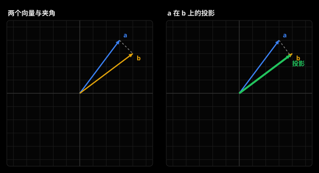
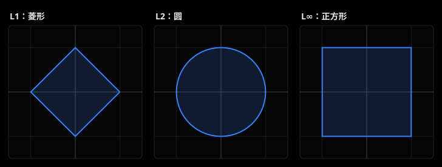
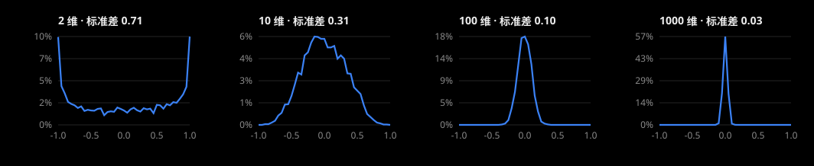
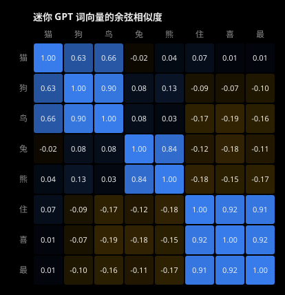

# 线性代数 01：向量、内积与范数

**读完你会知道**：向量是什么、点积为什么能衡量“像不像”、几种长度（范数）的区别、为什么高维里随机方向几乎都垂直，以及一个训练出来的模型里“相似的字”到底相似在哪。

**前置**：初中几何（勾股定理、余弦）。不需要别的。

**配套**：[互动页](demo/index.html)（拖动两个向量、换范数、调维度）· [图卡](cards/out/) · [代码](code/vectors.py)

---

## 第 1 层 · 一句话

向量是一排数；**点积**把两排数变成一个数，用来衡量它们“方向有多一致、各自有多长”。

## 第 2 层 · 白话

同一个向量有两种看法：

| 看法 | $[3,4]$ 是什么 |
|---|---|
| 一排数 | 两个特征：第一项 3，第二项 4 |
| 一支箭头 | 从原点向右 3 格、向上 4 格 |

大模型里每个词都是一个向量（常见几百到几千维）。画不出来，但算法和二维完全一样。

三个最基本的操作：

- **相加**：对应位置相加，几何上是首尾相接。
- **数乘**：每项乘同一个数，箭头拉长或反向。
- **点积**：对应位置相乘再全部加起来，得到**一个数**。

## 第 3 层 · 手算一遍

$a=[3,4]$，$b=[4,3]$。

1. 点积：$a\cdot b=3\times4+4\times3=24$
2. 长度：$\lVert a\rVert=\sqrt{3^2+4^2}=5$，$\lVert b\rVert=5$
3. 余弦相似度：$\dfrac{a\cdot b}{\lVert a\rVert\,\lVert b\rVert}=\dfrac{24}{25}=0.96$，对应夹角约 $16.3^\circ$
4. 两点距离：$\lVert a-b\rVert=\lVert[-1,1]\rVert=\sqrt2\approx1.414$

**投影**：$a$ 在 $b$ 方向上的“影子”是 $\dfrac{a\cdot b}{b\cdot b}\,b=\dfrac{24}{25}[4,3]=[3.84,\,2.88]$。

## 第 4 层 · 数学

### 点积的两种写法

$$
a\cdot b=\sum_i a_ib_i=\lVert a\rVert\,\lVert b\rVert\cos\theta
$$

为什么相等：对三角形 $0,a,b$ 用余弦定理，$\lVert a-b\rVert^2=\lVert a\rVert^2+\lVert b\rVert^2-2\lVert a\rVert\lVert b\rVert\cos\theta$；左边按坐标展开是 $\lVert a\rVert^2+\lVert b\rVert^2-2\,a\cdot b$。两边一比就得到。

因此：同向时点积为正且最大，垂直时为 0，反向时为负。又因为 $|\cos\theta|\le1$，有 **柯西-施瓦茨不等式** $|a\cdot b|\le\lVert a\rVert\lVert b\rVert$。

### 三种“像”的度量

| 度量 | 公式 | 受长度影响吗 |
|---|---|---|
| 点积 | $a\cdot b$ | 受影响，越长分数越大 |
| 余弦相似度 | $\cos\theta$ | 不受影响，只看方向 |
| 欧氏距离 | $\lVert a-b\rVert$ | 受影响，越小越像 |

当两个向量都缩放到长度 1 时，三者是一回事：

$$
\lVert a-b\rVert^2=2-2\cos\theta
$$

[注意力](../../3-llm/01-attention/)用点积打分；向量检索常用余弦相似度。

### 范数：几种量长度的办法

$$
\lVert x\rVert_1=\sum_i|x_i|,\qquad \lVert x\rVert_2=\sqrt{\sum_i x_i^2},\qquad \lVert x\rVert_\infty=\max_i|x_i|
$$

对 $a=[3,4]$ 分别是 $7$、$5$、$4$。“长度等于 1 的点”画出来形状不同：

它们在机器学习里反复出现：L2 用于权重衰减和梯度裁剪；L1 的尖角使得用它做惩罚时容易把参数压到恰好为 0；L∞ 限制“改动最大的那一项”。[RMSNorm](../../3-llm/tf-01-block/) 里除的均方根就是 $\lVert x\rVert_2/\sqrt d$。

## 第 5 层 · 实验

### 实验一：高维里随机方向几乎垂直

每个维度独立取标准正态随机数，生成两个向量，算夹角余弦。重复 2 万次（`code/vectors.py`）：

| 维度 $d$ | 余弦的标准差 | $1/\sqrt d$ | 点积的标准差 | $\sqrt d$ | 夹角在 80°–100° 的比例 |
|---|---|---|---|---|---|
| 2 | 0.705 | 0.707 | 1.42 | 1.41 | 11.2% |
| 10 | 0.316 | 0.316 | 3.15 | 3.16 | 39.3% |
| 100 | 0.100 | 0.100 | 10.05 | 10.00 | 91.8% |
| 1000 | 0.032 | 0.032 | 31.80 | 31.62 | 100% |

两条规律：

- 维度越高，随机的两个方向越接近垂直，所以高维空间“装得下”很多彼此几乎不干扰的方向。
- 点积的波动按 $\sqrt d$ 增长。这正是[注意力里要除以 $\sqrt{d_k}$](../../3-llm/attn-04-softmax-scale/) 的原因。

### 实验二：模型学到的“相似”是什么

取[迷你 GPT](../../3-llm/tf-04-mini-gpt/) 训练出来的 32 维词向量，算两两余弦相似度：

分成了三组：**猫、狗、鸟**（0.63–0.90），**兔、熊**（0.84），**住、喜、最**（0.91–0.92）。组与组之间都很低（−0.19 到 0.13）。

为什么“兔”和“猫”不像？它们不都是动物吗？回到语料看用法：

| 字 | 在语料里的位置 |
|---|---|
| 猫、狗、鸟 | 跟在“小”后面（小猫、小狗、小鸟） |
| 兔、熊 | 出现在主语开头（兔子、熊猫） |
| 住、喜、最 | 紧接主语之后，开始说一件事 |

也就是说，这个模型里相近的是**用法相近**的字，而不是人觉得意思相近的字。模型只见过文字之间的搭配，没有别的信息。

换 3 个随机种子重新训练（`python vectors.py --seeds`），分组一样稳定：猫-狗 0.62–0.63，兔-熊 0.85–0.90，猫-兔 −0.03–0.05。

**局限**：语料只有 20 种句子，48 个字。大模型的词向量从海量文本里学，能反映的关系丰富得多，但依据同样是“怎么被使用”。另外“熊”也出现在“熊猫”里，和猫相邻。

## 练习

1. $x=[1,-2,2]$，求 L1、L2、L∞ 范数。
2. $a=[1,2]$，$b=[-2,1]$，夹角是多少？
3. 把 $a$ 放大 10 倍，点积、余弦、欧氏距离哪个不变？
4. 两个长度为 1 的向量距离是 1，它们的余弦相似度是多少？

参考答案

1. L1 = 5，L2 = 3，L∞ = 2。
2. 点积 $=-2+2=0$，垂直，$90^\circ$。
3. 只有余弦不变。
4. $1=2-2\cos\theta$，$\cos\theta=0.5$（$60^\circ$）。

## 下一步

- 让矩阵动起来向量 → [线性代数 02：矩阵与线性变换](../la-02-matrix/)

## 说明

本篇是标准线性代数内容。表格和相似度数字由 [`code/vectors.py`](code/vectors.py) 实际运行得到（NumPy 2.0.2）。互动页里的随机实验用的是浏览器里的另一套随机数，数值会有小幅差异。
