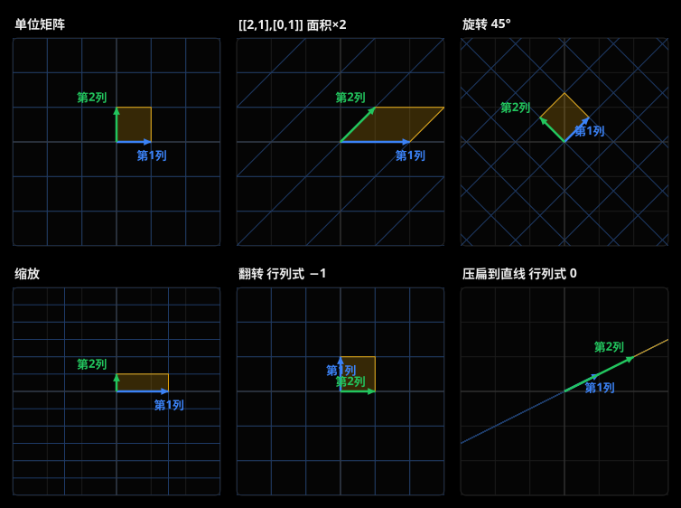
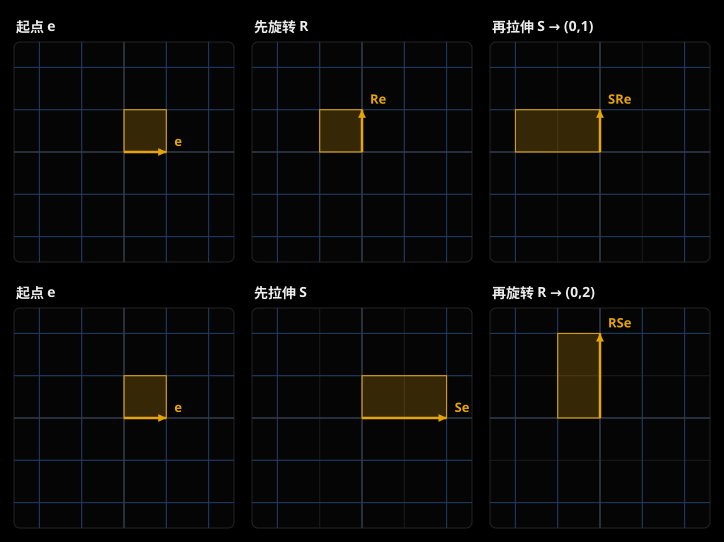

# 线性代数 02：矩阵与线性变换

**读完你会知道**：矩阵乘向量在做什么、矩阵相乘为什么不能换顺序、行列式和秩表示什么、旋转矩阵怎么用在位置编码里，以及为什么同样的结果换个括号能快几十倍。

**前置**：[线性代数 01：向量、内积与范数](../la-01-vectors/)。

**配套**：[互动页](demo/index.html)（拖动矩阵看网格变形、对比相乘顺序、算乘法次数）· [图卡](cards/out/) · [代码](code/transforms.py)

---

## 第 1 层 · 一句话

矩阵是一个**把向量变成向量的机器**；它的每一列写着“某个坐标轴被搬到哪里”。

## 第 2 层 · 白话

“线性”的意思是：整张网格变形后，直线仍是直线、等间距仍是等间距、原点不动。旋转、缩放、翻转、斜切都是；平移和弯曲不是。

只要知道两根基本箭头 $[1,0]$ 和 $[0,1]$ 被搬到哪，整张网格就确定了。矩阵的两列记的就是这两个去处。

## 第 3 层 · 手算一遍

$$
A=\begin{bmatrix}2&1\\0&1\end{bmatrix},\quad x=\begin{bmatrix}1\\2\end{bmatrix}
$$

两种算法，结果一样：

- **按行**：每一行和 $x$ 做点积。$[2\cdot1+1\cdot2,\;0\cdot1+1\cdot2]=[4,2]$
- **按列**：用 $x$ 的分量给各列加权。$1\times\begin{bmatrix}2\\0\end{bmatrix}+2\times\begin{bmatrix}1\\1\end{bmatrix}=\begin{bmatrix}4\\2\end{bmatrix}$

按列的看法更能看出几何意义：$x$ 说的是“沿第一根轴走 1 步、第二根轴走 2 步”，只不过轴已经换成了新的。

### 先后顺序很重要

$R$ 是逆时针转 90°，$S$ 是横向拉长 2 倍，起点 $e=[1,0]$。

$$
R=\begin{bmatrix}0&-1\\1&0\end{bmatrix},\quad S=\begin{bmatrix}2&0\\0&1\end{bmatrix}
$$

| 做法 | 写法 | 结果 |
|---|---|---|
| 先转后拉 | $S(Re)$ | $[0,1]$ |
| 先拉后转 | $R(Se)$ | $[0,2]$ |

## 第 4 层 · 数学

### 矩阵乘法 = 变换接着变换

$$
(AB)_{ij}=\sum_k A_{ik}B_{kj}
$$

$AB$ 表示“先做 $B$，再做 $A$”，从右往左读。形状要接得上：$(m\times n)(n\times p)\to m\times p$。它满足结合律 $(AB)C=A(BC)$，一般**不满足交换律**。上例中 $SR=\begin{bmatrix}0&-2\\1&0\end{bmatrix}$，$RS=\begin{bmatrix}0&-1\\2&0\end{bmatrix}$。

### 行列式与秩

二维里：

$$
\det\begin{bmatrix}a&b\\c&d\end{bmatrix}=ad-bc
$$

它是单位正方形变形后的**面积倍数**，负号表示翻了面。

| 矩阵 | 行列式 | 秩 | 含义 |
|---|---|---|---|
| $[[2,1],[0,1]]$ | 2 | 2 | 面积变 2 倍 |
| $[[0,1],[1,0]]$ | −1 | 2 | 翻转，面积不变 |
| $[[1,2],[2,4]]$ | 0 | 1 | 整个平面被压到一条直线上 |

**秩** = 变换后还剩几个独立方向。行列式为 0 意味着信息丢了，这个变换**不可逆**。秩这个概念在[低秩近似](../la-04-svd/)和 LoRA 里是主角。

### 旋转矩阵与位置编码

$$
R(\theta)=\begin{bmatrix}\cos\theta&-\sin\theta\\\sin\theta&\cos\theta\end{bmatrix}
$$

旋转不改变长度和夹角，满足 $R^\top R=I$（这类矩阵叫**正交矩阵**），而且 $R(\alpha)^\top R(\beta)=R(\beta-\alpha)$。于是：

$$
\big(R(m\omega)q\big)\cdot\big(R(n\omega)k\big)=q^\top R\big((n-m)\omega\big)k
$$

右边只和**位置差** $n-m$ 有关。这就是旋转位置编码 [RoPE](../../3-llm/attn-06-position/) 的核心。取 $q=[1.6,\,0.4]$、$k=[1.0,\,1.2]$、$\omega=0.3$，位置差固定为 3：

| $q$ 的位置 | $k$ 的位置 | 点积 |
|---|---|---|
| 0 | 3 | 0.102292 |
| 10 | 13 | 0.102292 |
| 500 | 503 | 0.102292 |

### 行向量写法

数学书常写 $Ax$（向量是一列）。神经网络代码常写 $xW$（向量是一行，一批数据摞成 $X\in\mathbb R^{B\times d}$）。两者只差一个转置：$(xW)^\top=W^\top x^\top$。本仓库讲模型时用 $xW$。[FFN](../../3-llm/tf-02-ffn/) 的 $xW_1$ 就是把 $d$ 维变换到 $d_{ff}$ 维，非方阵表示输入输出维度不同。

## 第 5 层 · 代价与实验

$(m\times n)(n\times p)$ 需要 $m\cdot n\cdot p$ 次乘法。结合律说括号怎么加结果都一样，但**代价可能差很多**。$A,B$ 是 $3000\times3000$，$x$ 是向量：

| 写法 | 乘法次数 | 作者机器上耗时 |
|---|---|---|
| $(AB)x$ | $2.7\times10^{10}$ | 约 114 ms |
| $A(Bx)$ | $1.8\times10^{7}$ | 约 2 ms |

次数差 1500 倍，实测时间差约 57 倍。差距没有次数那么大，是因为矩阵乘矩阵在数值库里利用硬件的效率高得多。两个结果只差浮点舍入（相对差约 $10^{-15}$）。耗时随机器变化，请自己运行 [`code/transforms.py`](code/transforms.py)。

大模型推理里的很多优化，本质都是少算矩阵乘法或换个顺序算，比如 [KV cache](../../3-llm/attn-09-efficient/)。

## 练习

1. $A=[[1,2],[3,4]]$，$x=[1,1]$，按列的看法写出 $Ax$。
2. $\det[[3,1],[2,4]]$ 是多少？单位正方形变形后面积是多少？
3. $X$ 是 $32\times512$，$W$ 是 $512\times2048$，$XW$ 的形状和乘法次数？
4. 两次旋转的顺序可以交换吗（二维）？

参考答案

1. $1\times[1,3]+1\times[2,4]=[3,7]$。
2. $12-2=10$，面积 10。
3. $32\times2048$；$32\times512\times2048=33{,}554{,}432$。
4. 二维里可以：$R(\alpha)R(\beta)=R(\alpha+\beta)$。三维里一般不行。

## 下一步

- 哪些方向变换后不变向？→ [线性代数 03：特征值与特征分解](../la-03-eigen/)

## 来源

- 线性代数部分是标准内容。
- Su et al. *RoFormer: Enhanced Transformer with Rotary Position Embedding*, 2021. [arXiv:2104.09864](https://arxiv.org/abs/2104.09864)（旋转位置编码，按摘要）
