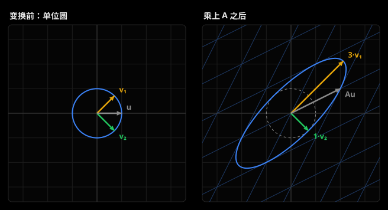
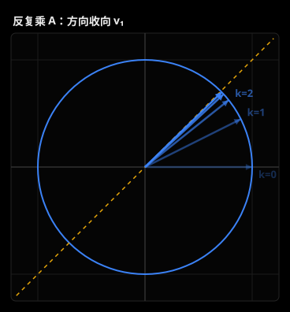
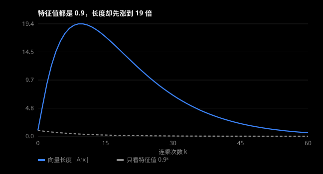

# 线性代数 03：特征值与特征分解

**读完你会知道**：什么是特征向量、怎么手算、为什么反复相乘最后只剩一个方向、网页排名和它有什么关系，以及一个反直觉的现象：特征值都小于 1，向量照样能先涨十几倍。

**前置**：[线性代数 02：矩阵与线性变换](../la-02-matrix/)。

**配套**：[互动页](demo/index.html)（改矩阵看圆变椭圆、做幂迭代、随机游走、看增长曲线）· [图卡](cards/out/) · [代码](code/eigen.py)

---

## 第 1 层 · 一句话

大多数向量经过矩阵会改变方向；少数**只被拉伸、不改方向**的就是特征向量，拉伸倍数是特征值。

## 第 2 层 · 白话

$$
Av=\lambda v\qquad(v\neq0)
$$

沿着特征向量的方向看，复杂的矩阵就只是“乘一个数”。反复作用很多次时尤其有用：乘一百次，就是把这个数乘一百次。

图里 $u$ 变换后方向变了；$v_1,v_2$ 方向没变，只是分别放大 3 倍和 1 倍。

## 第 3 层 · 手算一遍

$$
A=\begin{bmatrix}2&1\\1&2\end{bmatrix}
$$

1. $Av=\lambda v$ 有非零解，要求 $\det(A-\lambda I)=0$
2. $(2-\lambda)^2-1=0\Rightarrow\lambda=3$ 或 $1$
3. $\lambda=3$：$(A-3I)v=0$ 给出 $v_1=[1,1]$。验算 $A[1,1]=[3,3]$ ✓
4. $\lambda=1$：$v_2=[1,-1]$。验算 $A[1,-1]=[1,-1]$ ✓

两个快速检查：特征值之和等于对角线之和（$3+1=2+2$），特征值之积等于行列式（$3\times1=4-1$）。

## 第 4 层 · 数学

### 特征分解

如果有足够多线性无关的特征向量，排成 $P$ 的各列，特征值排在对角阵 $D$：

$$
A=PDP^{-1}\quad\Rightarrow\quad A^k=PD^kP^{-1}
$$

求高次幂只需把对角线上的数各自求幂。上例 $A^5=\begin{bmatrix}122&121\\121&122\end{bmatrix}$，直接连乘和用分解算结果一致。

**对称矩阵**最省心：特征值都是实数，特征向量可以取成两两垂直（$A=QDQ^\top$，$Q$ 正交）。协方差矩阵、Hessian 都是对称的。

### 不是所有矩阵都这么听话

| 矩阵 | 情况 |
|---|---|
| 旋转 90° $[[0,-1],[1,0]]$ | 实数范围内没有任何方向不变；特征值是 $\pm i$ |
| 剪切 $[[1,1],[0,1]]$ | 特征值 1（二重），但只有一个独立特征向量，**无法对角化** |
| $3I$ | 每个方向都是特征向量 |

非方阵没有特征值，这时要用[奇异值分解](../la-04-svd/)。

## 第 5 层 · 实验

### 实验一：幂迭代

任取一个向量，反复“乘 $A$，再缩放到长度 1”：

| 步数 | 向量 | 与 $[1,1]$ 的夹角 | $v^\top Av$ |
|---|---|---|---|
| 0 | [1.0000, 0.0000] | 45.0° | 2.000000 |
| 1 | [0.8944, 0.4472] | 18.4° | 2.800000 |
| 2 | [0.7809, 0.6247] | 6.3° | 2.975610 |
| 4 | [0.7158, 0.6983] | 0.71° | 2.999695 |
| 6 | [0.7081, 0.7061] | 0.08° | 2.999996 |

每一步夹角大约缩小到三分之一，这个比例就是 $|\lambda_2/\lambda_1|=1/3$。最后一列趋向最大特征值 3。前提是起点在 $v_1$ 方向上有分量，且最大特征值的模长唯一。

### 实验二：随机游走与网页排名

三个页面：A 链到 B 和 C，B 链到 C，C 链回 A。每一步随机点一个链接。把转移概率写成矩阵（第 $j$ 列 = 从页面 $j$ 出发）：

$$
P=\begin{bmatrix}0&0&1\\0.5&0&0\\0.5&1&0\end{bmatrix}
$$

从 A 出发：

| 步数 | A | B | C |
|---|---|---|---|
| 0 | 1.000 | 0.000 | 0.000 |
| 1 | 0.000 | 0.500 | 0.500 |
| 5 | 0.500 | 0.125 | 0.375 |
| 10 | 0.406 | 0.188 | 0.406 |
| 20 | 0.399 | 0.200 | 0.400 |

趋向 $[0.4,0.2,0.4]$，它满足 $P\pi=\pi$，即**特征值 1 的特征向量**。另外两个特征值是 $-0.5\pm0.5i$，模长约 0.707，决定了收敛快慢。PageRank 的出发点就是这个想法，实际算法还加了“随机跳转”一项。

### 实验三：特征值小于 1 也能先暴涨

$$
A=\begin{bmatrix}0.9&5\\0&0.9\end{bmatrix},\quad x=[0,1]
$$

两个特征值都是 0.9，直觉上 $\lVert A^kx\rVert$ 应该一路缩小。实际：

| $k$ | 0 | 1 | 5 | 9 | 20 | 50 | 100 |
|---|---|---|---|---|---|---|---|
| 长度 | 1 | 5.08 | 16.4 | **19.4** | 13.5 | 1.43 | 0.015 |

- **特征值决定很多步以后的趋势**（最终确实衰减到 0）。
- **单步最多能放大多少，由最大奇异值决定**，这里是 5.16。

这个矩阵的两个特征方向重合（无法对角化），所以能出现这种瞬时放大。这和[深层网络里的梯度](../../3-llm/tf-01-block/)直接相关：层数有限时，只看特征值会判断错。

### 实验四：缩放差一点，连乘后差很多

$64\times64$ 随机矩阵，元素标准差取 $g/\sqrt{64}$，对单位向量连乘 50 次（20 个随机种子，长度取几何平均）：

| $g$ | 最大特征值模长（平均） | $\lVert A^{50}x\rVert$ |
|---|---|---|
| 0.9 | 0.96 | 0.041 |
| 1.0 | 1.07 | 8.0 |
| 1.1 | 1.17 | 942 |

$g$ 从 0.9 到 1.1，结果差了两万多倍。有限大小的矩阵，最大特征值模长会比 $g$ 偏大一些。真实网络每层的矩阵不同、中间还有非线性，这里只是示意指数级的敏感性；它是初始化尺度要仔细选的原因之一。

## 练习

1. 求 $[[4,2],[1,3]]$ 的特征值。
2. $A$ 的特征值是 2 和 0.5，$A^{10}$ 的特征值是什么？
3. 投影矩阵满足 $P^2=P$，它的特征值只能是哪些？
4. 实验一里若起点是 $[1,-1]$，幂迭代会发生什么？

参考答案

1. $(4-\lambda)(3-\lambda)-2=\lambda^2-7\lambda+10=0$，$\lambda=5,2$。
2. $1024$ 和 $1/1024$。
3. $\lambda^2=\lambda$，所以只能是 0 或 1。
4. 它本身就是 $\lambda=1$ 的特征向量，方向永远不变。（换成一般的矩阵和起点，浮点误差会慢慢带进主特征方向的分量。）

## 下一步

- 对任何矩阵都适用的分解 → [线性代数 04：SVD 与低秩近似](../la-04-svd/)

## 来源

- 线性代数部分是标准内容；数字由 [`code/eigen.py`](code/eigen.py) 实际运行得到。
- Brin & Page. *The anatomy of a large-scale hypertextual Web search engine*. Computer Networks and ISDN Systems 30, 1998. [doi:10.1016/S0169-7552(98)00110-X](https://doi.org/10.1016/S0169-7552(98)00110-X)
