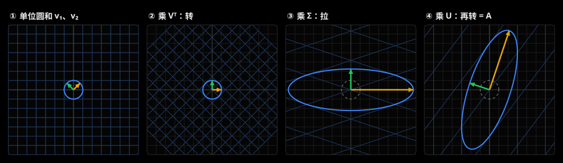
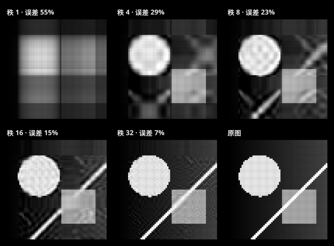
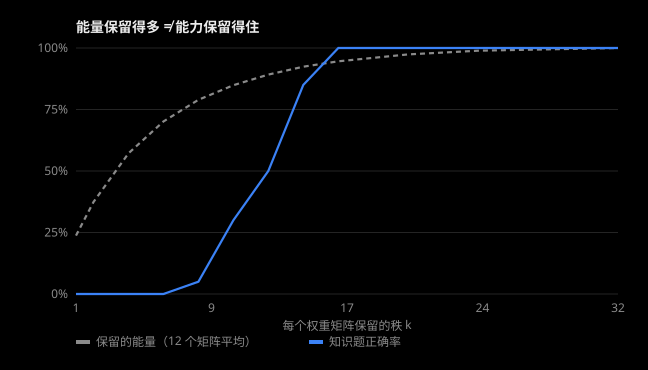

# 线性代数 04：SVD 与低秩近似

**读完你会知道**：任何矩阵都能拆成“转、拉、再转”三步、怎么手算、怎么用少得多的数字近似一个矩阵、把一个训练好的小模型压成低秩会发生什么，以及 LoRA 为什么能省那么多参数。

**前置**：[线性代数 02](../la-02-matrix/)、[线性代数 03](../la-03-eigen/)。

**配套**：[互动页](demo/index.html)（画图后调秩、看奇异值、现场压缩迷你 GPT）· [图卡](cards/out/) · [代码](code/lowrank.py)

---

## 第 1 层 · 一句话

SVD 把任意矩阵写成一串“重要程度从大到小”的简单矩阵之和；只留前几个，就得到最好的近似。

## 第 2 层 · 白话

$$
A=U\Sigma V^\top
$$

| 部分 | 做什么 |
|---|---|
| $V^\top$ | 旋转（可能带翻转），把特别的输入方向转到坐标轴上 |
| $\Sigma$ | 沿各坐标轴拉伸，倍数 $\sigma_1\ge\sigma_2\ge\dots\ge0$ 叫**奇异值** |
| $U$ | 再旋转到输出位置 |

和[特征分解](../la-03-eigen/)比：SVD **对任何矩阵都成立**（长方形也行），奇异值永远是非负实数；代价是输入和输出用两套不同的方向。

## 第 3 层 · 手算一遍

$$
A=\begin{bmatrix}3&0\\4&5\end{bmatrix}
$$

1. 算 $A^\top A=\begin{bmatrix}25&20\\20&25\end{bmatrix}$
2. 它的特征值是 45 和 5，所以 $\sigma_1=\sqrt{45}\approx6.708$，$\sigma_2=\sqrt5\approx2.236$
3. 特征向量：$v_1=\frac{1}{\sqrt2}[1,1]$，$v_2=\frac{1}{\sqrt2}[1,-1]$
4. $u_i=Av_i/\sigma_i$：$u_1=\frac{1}{\sqrt{10}}[1,3]$，$u_2=\frac{1}{\sqrt{10}}[3,-1]$
5. 只留第一项：

$$
\sigma_1u_1v_1^\top=\begin{bmatrix}1.5&1.5\\4.5&4.5\end{bmatrix}
$$

误差矩阵是 $\begin{bmatrix}1.5&-1.5\\-0.5&0.5\end{bmatrix}$，各元素平方和开根号等于 $\sqrt5=\sigma_2$。**扔掉的奇异值就是误差。**

（数值库给出的 $u_i,v_i$ 可能整对变号，乘起来结果一样。）

## 第 4 层 · 数学

### 低秩展开

$$
A=\sum_{i=1}^{r}\sigma_i\,u_iv_i^\top,\qquad A_k=\sum_{i=1}^{k}\sigma_i\,u_iv_i^\top
$$

每一项 $u_iv_i^\top$ 的秩都是 1，$r$ 是矩阵的秩。

### Eckart–Young 定理

在所有秩不超过 $k$ 的矩阵里，$A_k$ 离 $A$ 最近（按元素平方和开根号的 Frobenius 范数，也按最大奇异值定义的谱范数），误差是：

$$
\lVert A-A_k\rVert_F=\sqrt{\sum_{i>k}\sigma_i^2}
$$

“奇异值平方和”常被称为**能量**，前 $k$ 个占的比例表示保留了多少。

### 省多少

$m\times n$ 的矩阵要存 $mn$ 个数；秩 $k$ 近似只需 $k(m+n+1)$ 个。**只有 $k$ 明显小于 $\min(m,n)$ 时才划算。**

## 第 5 层 · 实验

### 实验一：压缩一张图

一张 $64\times64$ 的合成灰度图（渐变、圆、方块、斜线）：

| 秩 $k$ | 要存的数字 | 占原图 | 相对误差 |
|---|---|---|---|
| 1 | 129 | 3.1% | 55.3% |
| 4 | 516 | 12.6% | 29.0% |
| 8 | 1,032 | 25.2% | 23.0% |
| 16 | 2,064 | 50.4% | 15.0% |
| 32 | 4,128 | **100.8%** | 6.5% |

直接用公式 $\sqrt{\sum_{i>k}\sigma_i^2/\sum\sigma_i^2}$ 算出的误差和实际重建的误差一致。注意最后一行：秩 32 比直接存原图还费空间。斜线这种“不沿坐标轴”的结构最难压。互动页里可以比较：纯渐变秩 1 就完全还原，棋盘格秩 2，随机噪声怎么压都差。

### 实验二：把迷你 GPT 压成低秩

[迷你 GPT](../../3-llm/tf-04-mini-gpt/) 两层共有 12 个权重矩阵。把它们全部换成秩 $k$ 近似（词向量和位置向量不动，不重新训练）：

| 秩 $k$（满秩 32） | 验证损失 | 20 道知识题 | 平均保留能量 |
|---|---|---|---|
| 4 | 4.98 | 0 | 57% |
| 8 | 2.59 | 1 | 79% |
| 12 | 0.589 | 10 | 89% |
| 16 | 0.389 | 20 | 95% |
| 24 | 0.381 | 20 | 99% |
| 32（原模型） | 0.381 | 20 | 100% |

**保留了 79% 的能量，能力几乎归零。** SVD 保证的是“矩阵元素上最接近”，不保证“模型行为最接近”：那些占能量很少的方向，对输出可能很关键。这里要到秩 16 才全部答对，此时存储量仍有原来的 75%。

**局限**：这是一个很小的、从零训练的模型，本来就没多少冗余；逐层粗暴截断且不微调。它不能说明大模型能压到什么程度。

### LoRA：低秩的是“改动”

LoRA 并不把原权重压成低秩。它把原权重 $W$ **冻结**，只训练一个低秩的修改量：

$$
W'=W+BA,\qquad B\in\mathbb R^{d\times r},\;A\in\mathbb R^{r\times d},\; r\ll d
$$

以 $d=4096$ 的方阵为例（按参数个数算）：

| 秩 $r$ | $BA$ 的参数 | 占完整矩阵 |
|---|---|---|
| 8 | 65,536 | 0.39% |
| 16 | 131,072 | 0.78% |
| 64 | 524,288 | 3.12% |

两个实验问的是不同问题：上面是“原模型能不能用低秩表示”，LoRA 赌的是“微调所需的改动能用低秩表示”。大纲里“微调”一节会专门讲。

## 练习

1. 矩阵 $[[2,0],[0,-3]]$ 的奇异值是什么？
2. 某矩阵奇异值是 $10,5,2,1$。秩 2 近似的 Frobenius 误差和保留能量各是多少？
3. $1000\times800$ 的矩阵，秩 20 近似要存多少个数？
4. 一个秩 1 矩阵最少需要几个数来表示（$m\times n$）？

参考答案

1. $3$ 和 $2$（奇异值非负且从大到小）。
2. 误差 $\sqrt{4+1}=\sqrt5$；能量 $125/130\approx96.2\%$。
3. $20\times(1000+800+1)=36{,}020$。
4. $m+n$（把 $\sigma$ 并进某个向量；甚至还能再省 1 个，因为整体缩放可以互换）。

## 来源

- Eckart & Young. *The approximation of one matrix by another of lower rank*. Psychometrika 1(3):211–218, 1936. [doi:10.1007/BF02288367](https://doi.org/10.1007/BF02288367)（本篇引用定理的标准表述，未通读原文）
- Hu et al. *LoRA: Low-Rank Adaptation of Large Language Models*, 2021. [arXiv:2106.09685](https://arxiv.org/abs/2106.09685)（冻结原权重、$W_0+BA$，见第 4.1 节）
- 实验数字由 [`code/lowrank.py`](code/lowrank.py) 实际运行得到；互动页里的结果与脚本核对一致。
