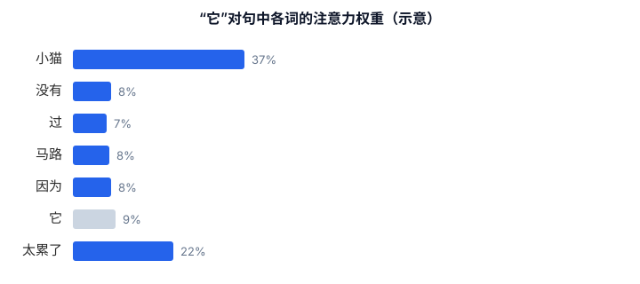

# 基础 A：大模型怎么“读”一句话

**读完你会知道**：注意力每一步算了什么、q/k/v 从哪来、为什么是那一行公式、为什么它贵。

**前置**：向量的点积、softmax。没学过也没关系，各用一句话交代：

- 点积：两个向量对应位置相乘再相加，越“同向”结果越大。
- softmax：把一组任意数变成加起来等于 1 的正数，大的更大，小的更小。

**配套**：[互动版](demo/index.html)（可输入自己的句子、看完整分数表、猜答案）· [TikTok 图卡 9 张](cards/out/)。本篇的数字都由 [`_shared/engine.js`](../_shared/engine.js) 实时算出。

> 本章所有例子都是**玩具模型**：约 30 个词的词表、6 维向量、人工设定的矩阵，用来看清机制。它不是训练出来的，也会“出错”（见互动版的第三个示例句）。

## 1. 要解决的问题

“小猫没有过马路，因为它太累了。”

人一眼看出“它”是小猫。模型处理“它”这个词时，手里只有一个孤立的词向量，里面没有“小猫”的信息。要读懂它，就得**从句子里别的词那里取信息，并且知道该多取谁、少取谁**。

注意力就是做这件事的机制：每个词给所有词打分，再按分数从它们那里取信息。

## 2. 第一步：词变成向量 x

每个词先对应一个向量。这里用 6 个数描述：[有生命, 物体, 动作, 状态, 指代, 连接]。“它”是 `[0.2, 0, 0, 0, 1, 0]`，主要特征是“指代”。

真实模型里，向量有几百到上万维（GPT-3 为 12288），每一维没有人能直接读懂的含义，全部由训练得到。

## 3. 第二步：投影出 q、k、v

同一个 x，分别乘三个不同的矩阵 W_Q、W_K、W_V，得到三个向量：

| 向量 | 含义 | 用在哪 |
|---|---|---|
| $q$ 查询 | 我想找什么 | 与别人的 $k$ 比较 |
| $k$ 键 | 我能被怎样找到 | 被别人的 $q$ 比较 |
| $v$ 值 | 被选中时我提供什么 | 被加权求和 |

为什么要三个不同的矩阵，而不是直接拿 x 和 x 比？因为“我想找什么”和“我能被怎样找到”是两件事。比如“它”想找“有生命的词”，但“它”自己的特征是“指代”。W_Q 就负责把“指代”翻译成“去找有生命的词”。互动版里可以展开这三个矩阵看数值。

## 4. 第三步：两两打分，得到 n×n 的表

第 $i$ 个词对第 $j$ 个词的分数：

$$
s_{ij}=\frac{q_i\cdot k_j}{\sqrt{d_k}}
$$

所有 $i,j$ 排成一张 $n\times n$ 的表。再对每一行做 softmax，得到权重 $a_{ij}$，每行和为 1。


*图 1：“它”这一行的权重。向量与矩阵为人工设定的示意值。*

读这张表的方法：**每一行是一个提问的词，每一列是被看的词，点越大权重越大。** 互动版里整张表都能看，点某一行就高亮它。

## 5. 第四步：加权求和，取信息

用这一行的权重，对所有词的 $v$ 求加权和：

$$
o_i=\sum_j a_{ij}\,v_j
$$

$o_i$ 就是第 $i$ 个词读完整句话后的新表示。“它”的 $o$ 里，“小猫”的 $v$ 占了最大的份额，所以现在的“它”带着“小猫”的信息。

整句话一起算，写成矩阵，就是那一行公式：

$$
\mathrm{Attention}(Q,K,V)=\mathrm{softmax}\!\left(\frac{QK^{\top}}{\sqrt{d_k}}\right)V
$$

## 6. 为什么除以 √d_k

假设 $q$、$k$ 的各分量独立、均值 0、方差 1，则 $q\cdot k$ 的方差为 $d_k$。$d_k$ 越大，分数的绝对值越大，softmax 越容易“一家独大”，其余位置的梯度接近 0，训练变难。除以 $\sqrt{d_k}$，分数方差回到 1。

用随机向量实测（1 个 $q$、8 个 $k$，各 2000 次取平均）：$d=64$ 时，不缩放的最大权重约 88%，缩放后约 37%。互动版可拖动 $d$ 复现。

关于这一步的理由，常见的说法有两种：Alammar 的讲解侧重“让梯度更稳定”，3Blue1Brown 的文字版侧重“数值稳定”。两者描述的是同一件事的不同侧面。

## 7. 为什么贵

$n$ 个词两两打分，要算 $n\times n$ 个分数。上下文长度变为 10 倍，分数表变为 100 倍。时间 $O(n^2 d)$，空间 $O(n^2)$。长上下文的各种优化，大多在对付这张表。

## 8. 最小实现

```python
import math
import torch

def attention(q, k, v):
    # q, k, v: [B, n, d]
    scores = q @ k.transpose(-2, -1) / math.sqrt(q.size(-1))  # [B, n, n]
    weights = scores.softmax(dim=-1)                          # 每行和为 1
    return weights @ v                                        # [B, n, d]
```

## 9. 下一步

- 一个头只有一套 q/k 规则，句子里却有很多种关系 → [基础 B：多头](../02-multihead/)
- 生成文字时不能看后面的词；注意力还看不见词序 → [基础 C：掩码与位置](../03-mask-position/)

## 来源

- Bahdanau, Cho, Bengio. *Neural Machine Translation by Jointly Learning to Align and Translate*, 2014. 注意力最早用于翻译。
- Vaswani et al. *Attention Is All You Need*, 2017. 缩放点积注意力与 $\sqrt{d_k}$ 的说明。
- 讲解方式参考：Jay Alammar, *The Illustrated Transformer*；3Blue1Brown, *Attention in transformers, step-by-step*；Cho et al., *Transformer Explainer*（arXiv 2408.04619）。本章的图、例句和实现均为原创，未复制其内容。
