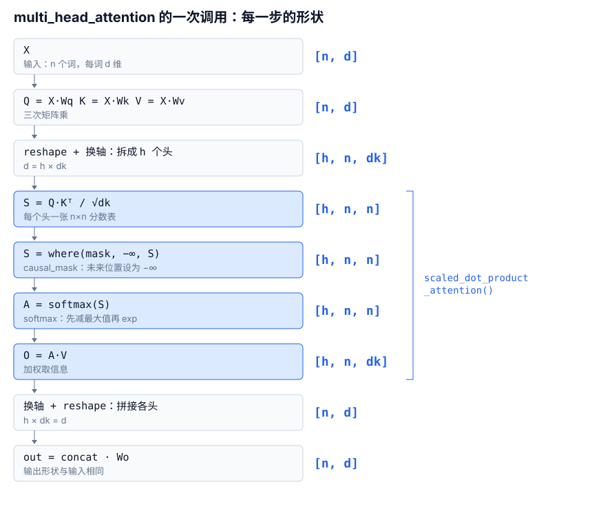

# 注意力 07：从零实现

**目标**：只用 NumPy，从零写出带掩码的多头注意力，并用测试证明它是对的。写完你就不再依赖任何框架的黑箱。

**配套代码**（可直接运行）：
- [`code/attention.py`](code/attention.py)：实现，约 60 行
- [`code/test_attention.py`](code/test_attention.py)：7 个测试
- [`code/attention_torch.py`](code/attention_torch.py)：PyTorch 版，并与官方实现对照（**未运行过**，见下）

**前置**：[注意力 02：手算](../attn-02-hand-calc/)、[注意力 03：形状](../attn-03-shapes/)。

## 怎么运行

```bash
pip install numpy
cd learn/3-llm/attn-07-from-scratch/code
python test_attention.py
```

预期输出 7 行“通过”和一行“全部 7 个测试通过”。（作者已用 NumPy 2.0.2、Python 3.9 实际运行通过。）

---

## 第 1 层 · 一句话

注意力只有三个函数：softmax、缩放点积注意力、拆头与合头。全部加起来不到 60 行。

## 第 2 层 · 白话

把前两篇的手算和形状追踪变成代码：手算的每一步对应一行，形状追踪的每一行形状注释对应一次 reshape 或 transpose。写代码时每一行都问自己：“这个张量现在是什么形状？”

---

## 第 3 层 · 逐个函数讲


*图：一次 `multi_head_attention` 调用里，每一步的张量形状。蓝色是 `scaled_dot_product_attention` 负责的部分。*

### 1. `softmax`

```python
def softmax(z, axis=-1):
    z = z - np.max(z, axis=axis, keepdims=True)   # 减最大值：结果不变，但不会溢出
    e = np.exp(z)
    return e / e.sum(axis=axis, keepdims=True)
```

测试证明：输入 `[1000, 1001, 999]` 不会得到 nan。如果不减最大值，`exp(1000)` 会溢出。依据是 [注意力 02：手算](../attn-02-hand-calc/) 里的“平移不变”。

### 2. `scaled_dot_product_attention`

```python
S = Q @ np.swapaxes(K, -1, -2) / np.sqrt(dk)   # [..., n, n]
if mask is not None:
    S = np.where(mask, -np.inf, S)             # 未来位置设为 -inf
A = softmax(S, axis=-1)
return A @ V, A
```

只有四行，对应公式 $\mathrm{softmax}(QK^\top/\sqrt{d_k})V$。写成 `[..., n, dk]` 的形式，意味着前面可以有任意多个批维度（`B`、`h`），不需要为多头重写。

### 3. `multi_head_attention`

拆头：`reshape(B, n, h, dk).transpose(0, 2, 1, 3)`；调用上面的函数；合头：`transpose(0, 2, 1, 3).reshape(B, n, d)`，再乘 $W_O$。形状每一步见 [注意力 03：形状](../attn-03-shapes/)。

### 4. `causal_mask`

`np.triu(np.ones((n, n), dtype=bool), k=1)`：上三角（不含对角线）为 True，即“位置 j > i，屏蔽”。

---

## 第 4 层 · 测试在检验什么

测试比代码更重要。好的测试检验的是**性质**，而不只是“跑起来不报错”：

| 测试 | 检验的性质 | 为什么有说服力 |
|---|---|---|
| `softmax` 每行和为 1、平移不变、不溢出 | softmax 的数学性质 | 对应推导，不依赖具体数字 |
| 与手算一致 | 对上 [注意力 02](../attn-02-hand-calc/) 的 $A$、$O$ | 把代码锚定到可手验的数字 |
| 多头 = 朴素循环 | 向量化的 reshape/transpose 没写错 | 朴素写法逐句逐头算，不容易写错 |
| 因果掩码：未来权重为 0，**改未来的词，前面位置的输出完全不变** | 真正的“不偷看” | 比只看掩码矩阵更强：它直接验证信息没有泄露 |
| 无位置编码时，打乱输入 = 输出同样被打乱；加位置编码后不再成立 | 注意力“看不见词序” | 与 [掩码与位置](../03-mask-position/) 的结论一致 |
| 随机向量实验：不缩放时最大权重 > 0.85，缩放后 < 0.5 | $\sqrt{d_k}$ 的作用 | 同一个统计现象，在代码里复现 |

“**改未来的词，前面的输出不变**”这个测试值得单独记住：它是检查任何自回归模型是否泄露未来信息的标准做法。

---

## 第 5 层 · 练习

**练习 1（必做）**：删掉 `softmax` 里“减最大值”那一行，运行测试，看哪个测试失败、怎么失败。

**练习 2**：把 `causal_mask` 改成“滑动窗口”：位置 i 只能看 `[i-w, i]` 范围内的词（`w=2`）。写一个测试证明：窗口外的词改变，输出不变。

**练习 3**：实现“分组查询注意力”（GQA）：`h=8` 个头的 Q，但只有 `g=2` 组 K、V，每组被 4 个头共享。提示：K、V 的头数是 `g`，用 `np.repeat(K, h // g, axis=1)` 扩展到 `h`。验证：当 `g=h` 时结果与原多头一致。

**练习 4**：给 `scaled_dot_product_attention` 增加一个 `return_scores` 选项，画出任意一个头的权重热力图（可用 matplotlib）。

**练习 5（概念）**：为什么测试里不直接比较“输出的具体数值”，而要比较“性质”？

### 答案要点

**练习 1**：`test_softmax_no_overflow` 失败，得到 nan（`exp(1000)` 是无穷大，`inf/inf` 得 nan）。其他小数值测试仍通过，说明这类 bug 只在极端输入下暴露，容易漏测。

**练习 2**：把 `np.triu(..., k=1)` 与 `np.tril(..., k=-w-1)` 的结果做“或”，两个区域都屏蔽。测试：改变 `X[:, :i-w, :]`（窗口左侧之外），位置 i 的输出不变。

**练习 3**：`K.shape = [B, g, n, dk]`，`np.repeat(K, h // g, axis=1)` 得到 `[B, h, n, dk]` 后就和原实现一样。`g=h` 时 `repeat` 的倍数为 1，结果应与多头一致；`g=1` 即多查询注意力（MQA）。

**练习 4**：略，思路是返回 `A[b, head]`，用 `plt.imshow` 画 `n×n` 矩阵。

**练习 5**：具体数值依赖随机种子、实现细节和浮点误差；性质（和为 1、不泄露未来、打乱后等变）是数学上必须成立的，对任何实现都有效，也更容易在出错时指出错在哪里。

---

## PyTorch 版说明

[`code/attention_torch.py`](code/attention_torch.py) 写了同样的逻辑，并与 `torch.nn.functional.scaled_dot_product_attention` 比较。**作者的机器没有安装 torch，这份代码没有运行过。** 请你第一次运行时自己确认：如果最大误差大于 1e-5，欢迎指出，我再修。

## 易错点

- **用 `+= -1e9` 代替 `-inf`**：能工作，但在半精度下可能溢出，也不够“干净”。
- **mask 的方向**：`True` 表示屏蔽，别和“保留”弄反。
- **忘记 `keepdims=True`**：广播会静默地把行按列减，得到错误结果但不报错。
- **在 macOS 上看到 NumPy 的“divide by zero in matmul”警告**：在作者的环境（NumPy 2.0.2，Accelerate 后端）里出现过，对比逐元素求和后发现结果完全一致（差 1e-14），是误报。

## 下一步

→ 下一步：[注意力 04：softmax 与 √d](../attn-04-softmax-scale/) · [注意力 08：真实模型](../attn-08-real-model/) · [注意力 09：高效注意力](../attn-09-efficient/) · [注意力 10：自测与小项目](../attn-10-selftest/)。
