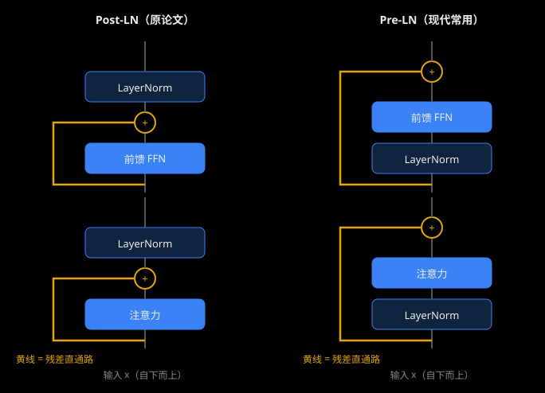
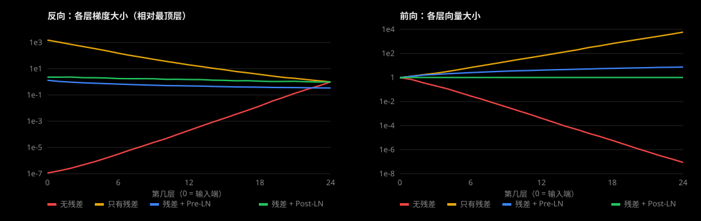

# Transformer 01：残差与 LayerNorm

**读完你会知道**：注意力怎么组装成一个“层”、为什么几十层叠起来还能训练、LayerNorm 和 RMSNorm 在算什么、Pre-LN 和 Post-LN 差在哪。

**前置**：[注意力基础](../01-attention/)、[多头](../02-multihead/)。

**配套**：[互动页](demo/index.html)（改向量看归一化、调层数看梯度、看对照实验）· [图卡](cards/out/)

---

## 第 1 层 · 一句话

**残差**给信息和梯度留一条直通路，**归一化**把数值拉回固定尺度；有了这两样，层才能越叠越深。

## 第 2 层 · 白话

一个 Transformer 层 = 两个子层（注意力、[FFN](../tf-02-ffn/)），每个子层外面都包着同样两样东西：

- **残差连接**：子层不直接替换输入，而是在输入上**加一笔修改**：$x \leftarrow x+\mathrm{Sublayer}(x)$。原信息不会丢，子层只需学“该改什么”。
- **归一化**：层层相加，数值会越来越大或越来越小；归一化把每个词的向量调回固定尺度。

放归一化的位置有两种：

## 第 3 层 · 手算一遍

一个词的向量 $x=[2,4,6,8]$。

**LayerNorm**：减均值，除以标准差。

1. 均值 $\mu=5$
2. 方差 $=\frac{9+1+1+9}{4}=5$，标准差 $\sigma\approx2.236$
3. 结果 $[-1.342,\,-0.447,\,0.447,\,1.342]$

**RMSNorm**：不减均值，只除以均方根。

1. 均方根 $=\sqrt{\frac{4+16+36+64}{4}}=\sqrt{30}\approx5.477$
2. 结果 $[0.365,\,0.730,\,1.095,\,1.461]$

两者之后都还要乘一个可学习的缩放 $g$（LayerNorm 另加偏置 $b$），让模型能自己决定最终尺度。

**注意归一化的方向**：LayerNorm 对**一个词的所有特征**求均值方差，和同批次的其他样本无关，所以训练和推理算法完全一样。BatchNorm 则是对一个批次里**同一个特征**求统计量，依赖批次大小，处理变长文本很别扭。

## 第 4 层 · 数学

### 残差为什么保住梯度

设第 $l$ 层 $x_{l+1}=x_l+f_l(x_l)$。链式法则：

$$
\frac{\partial L}{\partial x_l}=\frac{\partial L}{\partial x_N}\prod_{k=l}^{N-1}\left(I+\frac{\partial f_k}{\partial x_k}\right)
$$

没有残差时，连乘的是 $\partial f_k/\partial x_k$：只要它的“放大倍数”长期小于 1，几十层乘下来梯度就趋近 0。有了 $I$，展开后总有一项是直接传回来的 $\partial L/\partial x_N$，不经过任何 $f_k$。

这条直通路也有代价：前向时每层都往上加，向量会**越加越大**。所以还需要归一化。

### LayerNorm

$$
\mathrm{LN}(x)=g\odot\frac{x-\mu}{\sqrt{\sigma^2+\epsilon}}+b,\qquad
\mathrm{RMSNorm}(x)=g\odot\frac{x}{\sqrt{\frac1d\sum_i x_i^2+\epsilon}}
$$

把 $x$ 整体乘以任意正数，两者输出（几乎）不变；LayerNorm 还对整体加常数不变。反向传播时梯度会除以当前的标准差，所以**输入越大，传回的梯度越小**。

### Pre-LN 与 Post-LN

$$
\text{Post-LN: } x\leftarrow\mathrm{LN}\big(x+f(x)\big)\qquad
\text{Pre-LN: } x\leftarrow x+f\big(\mathrm{LN}(x)\big)
$$

Pre-LN 的直通路上**没有任何归一化**，从输出到输入是一条干净的加法链；因此最后需要再补一个归一化。原始论文用 Post-LN；GPT-2 起很多解码器模型改用 Pre-LN，LLaMA 用 Pre-LN 加 RMSNorm。Xiong 等（2020）的分析认为：Post-LN 在初始化时靠近输出层的参数梯度较大，学习率预热对它很有帮助；Pre-LN 初始化时梯度表现更稳，可以去掉预热。

## 第 5 层 · 实验

### 实验一：只看初始化时的信号

堆 24 层随机网络（每层 $f(z)=\mathrm{GELU}(Wz)$，$d=64$，不训练），量两件事。5 个随机种子取几何平均：

图里的梯度以**最终输出处**为 1。Pre-LN 那条在第 24 层不等于 1，是因为梯度先穿过了末尾那次归一化。

| 结构 | 输入端梯度 / 输出端梯度 | 顶层向量大小（输入为 1） |
|---|---|---|
| 无残差 | $1.1\times10^{-7}$ | $8.7\times10^{-8}$ |
| 只有残差 | $1.5\times10^{3}$ | $5.9\times10^{3}$ |
| 残差 + Pre-LN | 1.3 | 7.4 |
| 残差 + Post-LN | 2.3 | 1.0 |

- 无残差：信号和梯度一起消失。
- 只有残差：反过来爆炸。
- 加归一化：两种都稳住了。Pre-LN 的向量随层数缓慢变大（所以结尾要再归一化一次）。

**局限**：这是随机权重的玩具网络，量的是对**中间向量**的梯度。放大倍数（互动页里的 gain）改成 1.5 或 2，无残差那条会从消失变成爆炸，说明它对初始化尺度非常敏感。这个实验**没有**复现 Post-LN 与 Pre-LN 在真实训练中的差别。

### 实验二：真的训练一个小模型

用 [迷你 GPT](../tf-04-mini-gpt/)（Pre-LN）训练 1500 步，每种跑 3 个种子。“知识题”是 20 道按语料规则续写的题：

| 设置 | 验证损失（均值） | 知识题（3 个种子） |
|---|---|---|
| 2 层，有残差 | 0.380 | 20 / 20 / 20 |
| 2 层，无残差 | 0.432 | 20 / 19 / 16 |
| 6 层，有残差 | 0.380 | 20 / 20 / 20 |
| 6 层，无残差 | 3.491 | 0 / 0 / 0 |

2 层时去掉残差只是变差、变得不稳定；加到 6 层就**完全学不动**，生成的全是句号。层数一多，残差从“有帮助”变成“必需品”。这个结论限于本实验的模型大小、初始化和训练步数。

## 练习

1. $x=[1,1,5,5]$，手算 LayerNorm 与 RMSNorm（忽略 $g$、$b$、$\epsilon$）。
2. 把 $x$ 整体加 100，两种归一化的结果各怎么变？
3. 为什么 Pre-LN 结构在最后一层之后还要加一个 LayerNorm？

参考答案

1. 均值 3、标准差 2 → $[-1,-1,1,1]$。均方根 $\sqrt{13}\approx3.606$ → $[0.277,0.277,1.387,1.387]$。
2. LayerNorm 不变；RMSNorm 变得几乎全是 1（常数淹没了差异）。
3. 直通路上从没归一化过，最后输出的尺度随层数增长，送进输出层前需要拉回来。

## 下一步

- 层里的另一半 → [Transformer 02：FFN 与 SwiGLU](../tf-02-ffn/)

## 来源

- He et al. *Deep Residual Learning for Image Recognition*, 2015. [arXiv:1512.03385](https://arxiv.org/abs/1512.03385)
- Ba et al. *Layer Normalization*, 2016. [arXiv:1607.06450](https://arxiv.org/abs/1607.06450)
- Xiong et al. *On Layer Normalization in the Transformer Architecture*, 2020. [arXiv:2002.04745](https://arxiv.org/abs/2002.04745)（按摘要）
- Zhang & Sennrich. *Root Mean Square Layer Normalization*, 2019. [arXiv:1910.07467](https://arxiv.org/abs/1910.07467)
- Touvron et al. *LLaMA*, 2023. [arXiv:2302.13971](https://arxiv.org/abs/2302.13971)
- GPT-2 使用 Pre-LN：GPT-2 技术报告（2019，本篇未重新核对原文）
