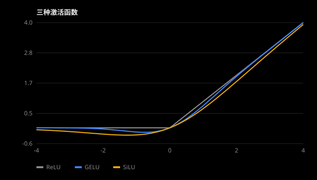
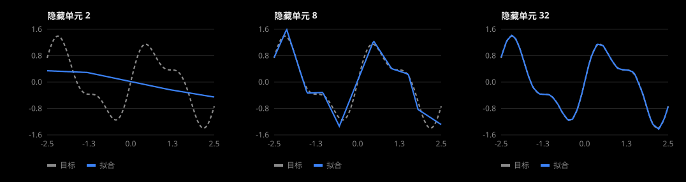

# Transformer 02：FFN 与 SwiGLU

**读完你会知道**：注意力之后那个“前馈网络”在干什么、为什么必须有激活函数、参数大头在哪里、SwiGLU 为什么用三个矩阵却不更费参数。

**前置**：[注意力基础](../01-attention/)、[Transformer 01：残差与 LayerNorm](../tf-01-block/)。

**配套**：[互动页](demo/index.html)（改数字手算、拖动激活函数、调隐藏层宽度、算真实模型参数量）· [图卡](cards/out/)

---

## 第 1 层 · 一句话

注意力让词和词**交换**信息，FFN 让每个词拿到信息后**自己加工**；一个 Transformer 层里大约三分之二的参数在 FFN。

## 第 2 层 · 白话

一个 Transformer 层有两道工序：

| 工序 | 做什么 | 词与词之间 |
|---|---|---|
| 注意力 | 从别的词那里取信息 | 混合 |
| FFN | 对每个词的向量做两次矩阵乘法，中间夹一个非线性函数 | **互不相干**，每个词单独过同一套权重 |

FFN 的形状总是“先放大、再缩回”：从 $d$ 维放大到 $d_{ff}$ 维（原论文 $d_{ff}=4d$），过激活函数，再缩回 $d$ 维。

$$
\mathrm{FFN}(x)=\sigma(xW_1+b_1)\,W_2+b_2
$$

## 第 3 层 · 手算一遍

取 $d=2$，$d_{ff}=3$，偏置为 0：

$$
x=[1,\,-1],\quad W_1=\begin{bmatrix}1&0&-1\\0&1&1\end{bmatrix},\quad W_2=\begin{bmatrix}2&1\\1&1\\0&3\end{bmatrix}
$$

1. 放大：$u=xW_1=[1,\,-1,\,-2]$
2. ReLU（负数变 0）：$h=[1,\,0,\,0]$
3. 缩回：$\mathrm{out}=hW_2=[2,\,1]$

**去掉激活函数试试**：$uW_2=[1,-6]$。而且它正好等于 $x\,(W_1W_2)$，其中 $W_1W_2=\begin{bmatrix}2&-2\\1&4\end{bmatrix}$。也就是说**两层没有激活的网络，等于一层**，堆多少层都还是一个矩阵。非线性是“深度”有意义的前提。

## 第 4 层 · 数学

### 激活函数

| 名字 | 公式 | 特点 |
|---|---|---|
| ReLU | $\max(0,x)$ | 原论文使用；负半轴梯度恒为 0 |
| GELU | $x\,\Phi(x)$，$\Phi$ 是标准正态分布函数 | 平滑版 ReLU；BERT、GPT-2 使用 |
| SiLU（Swish） | $x\cdot\sigma(x)$ | 同样平滑；SwiGLU 的门用它 |

GPT-2 用的是 GELU 的近似式 $0.5x\left(1+\tanh\left(\sqrt{2/\pi}\,(x+0.044715x^3)\right)\right)$，[迷你 GPT](../tf-04-mini-gpt/) 里也用这个。

### 为什么“宽”有用：分段拼接

一个 ReLU 单元贡献一个“折点”。隐藏单元越多，能拼出的折线越细：

下表是均方误差（越小越好）。隐藏层权重随机固定，**只解输出层**（最小二乘），不做梯度训练：

| 隐藏单元 | ReLU | GELU | 无激活 |
|---|---|---|---|
| 2 | 0.610 | 0.613 | 0.575 |
| 4 | 0.073 | 0.081 | 0.575 |
| 8 | 0.022 | 0.013 | 0.575 |
| 16 | 0.0038 | 0.000020 | 0.575 |
| 32 | 0.00012 | 0.000000073 | 0.575 |

读法：没有激活函数时，加多少单元误差都停在 0.575（只能画直线）。GELU 在这条**光滑**曲线上更快逼近，是因为目标本身光滑；这个玩具实验**不能**说明 GELU 在大模型里一定更好。

### SwiGLU：带门的 FFN

$$
\mathrm{FFN}_{\mathrm{SwiGLU}}(x)=\big(\mathrm{SiLU}(xW)\odot xV\big)\,W_2
$$

$\odot$ 是逐元素相乘。一路（$xW$ 过 SiLU）当“门”，决定另一路（$xV$）里每个分量放行多少。比普通 FFN 多了一个矩阵 $V$，且通常不带偏置。

**手算**（单个分量）：门的输入 $2$，内容 $0.5$：$\mathrm{SiLU}(2)=2\cdot\sigma(2)\approx 1.762$，乘 $0.5$ 得 $0.881$。门的输入换成 $-2$：$\mathrm{SiLU}(-2)\approx-0.238$，输出 $\approx-0.119$，几乎被关掉。

### 参数量：三个矩阵为什么不更贵

- 普通 FFN：$W_1,W_2$ 两个矩阵，$2\,d\,d_{ff}$。取 $d_{ff}=4d$，得 $8d^2$。
- 注意力：$W_Q,W_K,W_V,W_O$ 四个 $d\times d$，得 $4d^2$。
- 所以 **FFN : 注意力 = 2 : 1**，FFN 占一层的约 2/3。
- SwiGLU：三个矩阵 $3\,d\,d_{ff}$。把 $d_{ff}$ 缩到 $\tfrac{2}{3}\cdot 4d=\tfrac{8}{3}d$，得 $3d\cdot\tfrac83 d=8d^2$，和原来一样。

### 用真实模型验算

| | GPT-2 small | LLaMA 7B |
|---|---|---|
| $d$ / 层数 / $d_{ff}$ | 768 / 12 / 3072 | 4096 / 32 / 11008 |
| 每层注意力 | 2,362,368 | 67,108,864 |
| 每层 FFN | 4,722,432 | 135,266,304 |
| FFN 占该层 | 66.6% | 66.8% |
| 全模型参数 | 124,439,808 | 6,738,415,616 |

说明：

- GPT-2 small 含偏置、词表 50257、位置表 1024、输出层与词向量共享。
- LLaMA 7B 无偏置、词表 32000、输出层独立；论文表格写作 6.7B。
- $\tfrac83\times4096\approx10923$，实际用 11008：参考实现把它向上取到 256 的整数倍（这一条依据公开的参考实现，本篇未逐行核对代码）。

## 第 5 层 · FFN 里存着什么

- 有研究把 FFN 看成**键值记忆**：$W_1$ 的每一列像一个“键”，匹配到某类输入时激活；$W_2$ 对应的行是“值”，决定往输出里写什么（Geva 等，2020）。这是一种解释视角，不是定论。
- FFN 参数最多，所以 **MoE（稀疏专家）** 通常就是把它换成很多份 FFN，每个词只走其中几份。大纲里“现代结构演进”一节会展开。

## 练习

1. $d=512$、$d_{ff}=2048$、无偏置，一层 FFN 多少参数？注意力呢？
2. 把手算里的 ReLU 换成“无激活”，输出是多少？它等于哪个单一矩阵作用在 $x$ 上？
3. 若坚持 $d_{ff}=4d$ 用 SwiGLU，FFN 参数变为原来的几倍？

参考答案

1. FFN：$2\times512\times2048=2{,}097{,}152$。注意力：$4\times512^2=1{,}048{,}576$。
2. $[1,-6]$，等于 $x\,(W_1W_2)$。
3. $3/2=1.5$ 倍。

## 下一步

- 把零件拼成三种整机 → [Transformer 03：三种架构](../tf-03-architectures/)

## 来源

- Vaswani et al. *Attention Is All You Need*, 2017. [arXiv:1706.03762](https://arxiv.org/abs/1706.03762)（FFN、$d_{ff}=2048$、ReLU）
- Shazeer. *GLU Variants Improve Transformer*, 2020. [arXiv:2002.05202](https://arxiv.org/abs/2002.05202)（SwiGLU、省略偏置、$d_{ff}$ 缩到 2/3）
- Touvron et al. *LLaMA*, 2023. [arXiv:2302.13971](https://arxiv.org/abs/2302.13971)（SwiGLU、$\tfrac23\cdot4d$、7B 配置）
- Geva et al. *Transformer Feed-Forward Layers Are Key-Value Memories*, 2020. [arXiv:2012.14913](https://arxiv.org/abs/2012.14913)
- Hendrycks & Gimpel. *Gaussian Error Linear Units*, 2016. [arXiv:1606.08415](https://arxiv.org/abs/1606.08415)（本篇未重新核对原文）
