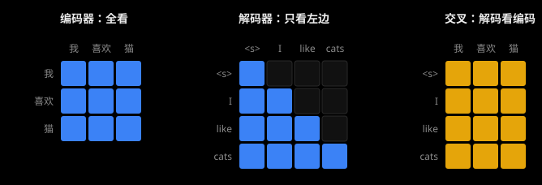

# Transformer 03：Encoder、Decoder 与三种架构

**读完你会知道**：同样的零件怎么拼成三种整机；区别只在两件事：**谁能看谁**（掩码）和**训练时猜什么**。

**前置**：[基础 C：掩码与位置](../03-mask-position/)、[Transformer 01](../tf-01-block/)、[Transformer 02](../tf-02-ffn/)。

**配套**：[互动页](demo/index.html)（切换架构看掩码、模拟掩码语言模型、看交叉注意力形状）· [图卡](cards/out/)

---

## 第 1 层 · 一句话

编码器双向看全句，适合“理解”；解码器只看左边，适合“生成”；编码器-解码器两者都有，用交叉注意力连接。

## 第 2 层 · 白话

| 架构 | 代表 | 能看到什么 | 训练时猜什么 | 擅长 |
|---|---|---|---|---|
| 只有编码器 | BERT | 左右都能看 | 被遮住的词 | 分类、抽取、向量检索 |
| 只有解码器 | GPT、LLaMA | 只能看左边 | 下一个词 | 生成，以及“用生成来做任务” |
| 编码器 + 解码器 | 原始 Transformer、T5 | 编码器看全句；解码器看左边 + 看编码结果 | 目标序列的下一个词 | 翻译、摘要等“一段进、一段出” |

## 第 3 层 · 掩码就是全部区别

*蓝格：可以看。黑格：看不到。黄色：解码器看编码器的结果。行是“提问的位置”，列是“被看的位置”。*

- **编码器自注意力**：$n\times n$ 全部可见。
- **解码器自注意力**：只保留 $j\le i$（因果掩码）。
- **交叉注意力**：$Q$ 来自解码器，$K$、$V$ 来自编码器。分数表是 $m\times n$（$m$ 个目标位置 × $n$ 个源位置），一般不是方阵，也不需要因果掩码，因为源句本来就是完整给定的。

### 形状手算

源句“我 喜欢 猫”（$n=3$），目标序列 `<s> I like cats`（$m=4$），$d=512$、8 个头、每头 64：

| 步骤 | 形状（单个头） |
|---|---|
| $Q$（解码器） | $4\times64$ |
| $K,V$（编码器输出） | $3\times64$ |
| 分数 $QK^\top$ | $4\times3$ |
| 输出 | $4\times64$ |

生成时源句不变，所以编码器只需跑**一次**，交叉注意力的 $K,V$ 可以一直复用。

## 第 4 层 · 训练目标

### 掩码语言模型（BERT）

随机挑 **15%** 的词作为预测目标。对每个被挑中的词：

- **80%** 换成 `[MASK]`
- **10%** 换成一个随机词
- **10%** 保持原样

模型要在这些位置猜回原词。后两种做法是为了让模型不能只在看到 `[MASK]` 时才认真工作：微调和实际使用时输入里根本没有 `[MASK]`。

### 下一个词（GPT 类）

一个长度 $n$ 的序列提供 $n-1$ 个训练样本：每个位置猜它右边那个词。因果掩码保证猜的时候看不到答案。[迷你 GPT](../tf-04-mini-gpt/) 的对照实验里，去掉掩码后训练损失会变得“好得离谱”，生成却是坏的。

### 序列到序列

编码器读源句；解码器用**教师强制**训练：把正确的目标序列右移一位当输入（开头放 `<s>`），逐位置猜下一个词。生成时才改为把自己的输出一个个喂回去。T5 把各种任务都写成“输入文字 → 输出文字”，统一用这一种目标。

## 第 5 层 · 参数量与现状

| 模型 | 结构 | 层数 | $d$ | 头数 | $d_{ff}$ | 参数量（论文） |
|---|---|---|---|---|---|---|
| Transformer base | 编码器 + 解码器 | 6 + 6 | 512 | 8 | 2048 | 65M |
| BERT base | 编码器 | 12 | 768 | 12 | 3072 | 110M |
| GPT-2 small | 解码器 | 12 | 768 | 12 | 3072 | 约 124M（按配置算出，见[上一篇](../tf-02-ffn/)） |

**用公式复核 Transformer base**（忽略偏置和归一化）：

- 编码层：注意力 $4d^2\approx1.05$M + FFN $2\,d\,d_{ff}\approx2.10$M ≈ 3.15M
- 解码层：多一个交叉注意力，≈ 4.19M
- 六层各一套：$6\times(3.15+4.19)\approx44$M
- 论文英德任务的共享词表约 3.7 万：$37000\times512\approx19$M
- 合计约 **63M**，与论文的 65M 同一量级（差额来自忽略项和词表取整）。

### 为什么现在的大语言模型多是“只有解码器”

常见的解释有三条：训练目标单一（猜下一个词，任何文本都能当数据）；生成是它的原生能力；翻译、分类等任务可以改写成“续写”交给它。编码器和编码器-解码器没有被淘汰，在向量检索、分类、语音识别等场景仍在使用。这是对现状的概括，不是定理。

## 练习

1. 源句 10 个词、已生成 6 个词时，交叉注意力分数表是什么形状？解码器自注意力呢？
2. 一个 20 词的句子，按 BERT 的比例，期望多少个位置要预测？其中期望几个真的变成 `[MASK]`？
3. 为什么交叉注意力不需要因果掩码？

参考答案

1. 交叉：$6\times10$；自注意力：$6\times6$（下三角可见）。
2. 目标位置 $20\times15\%=3$ 个；其中 $3\times80\%=2.4$ 个换成 `[MASK]`。
3. 它看的是源句，源句在生成开始前就完整给定，看哪个位置都不算偷看答案。

## 下一步

- 亲手拼一个能训练的解码器 → [Transformer 04：从零训练迷你 GPT](../tf-04-mini-gpt/)

## 来源

- Vaswani et al. *Attention Is All You Need*, 2017. [arXiv:1706.03762](https://arxiv.org/abs/1706.03762)（编码器-解码器、base 配置、65M）
- Devlin et al. *BERT*, 2018. [arXiv:1810.04805](https://arxiv.org/abs/1810.04805)（掩码语言模型、15% 与 80/10/10、base 110M）
- Raffel et al. *Exploring the Limits of Transfer Learning with a Unified Text-to-Text Transformer*, 2019. [arXiv:1910.10683](https://arxiv.org/abs/1910.10683)
- Radford et al. *Language Models are Unsupervised Multitask Learners*（GPT-2 技术报告），2019（本篇未重新核对原文）
