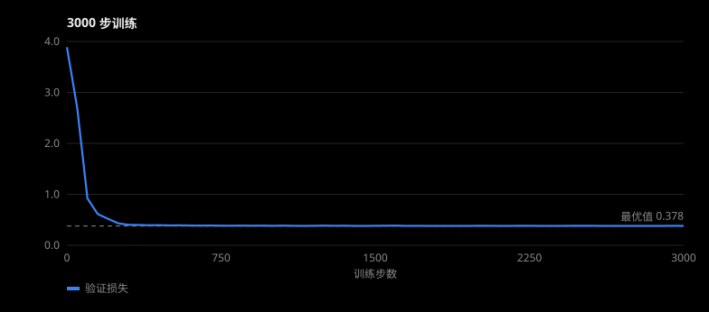

# Transformer 04：从零训练迷你 GPT

**目标**：只用 NumPy，把前面所有零件拼成一个解码器模型，**手写反向传播**，真的训练它，然后打开看它学到了什么。

**前置**：[Transformer 01](../tf-01-block/)、[02](../tf-02-ffn/)、[03](../tf-03-architectures/)、[注意力 07：从零实现](../attn-07-from-scratch/)。

**配套**：[互动页](demo/index.html)（在浏览器里运行训练好的模型：续写、看注意力、关掉某个头）· [图卡](cards/out/) · 代码：
- [`code/corpus.py`](code/corpus.py)：造句规则
- [`code/minigpt.py`](code/minigpt.py)：模型、反向传播、AdamW
- [`code/test_grad.py`](code/test_grad.py)：梯度检查
- [`code/train.py`](code/train.py)：训练与对照实验
- [`code/optimal.py`](code/optimal.py)：最优损失

## 怎么运行

```bash
pip install numpy
cd learn/3-llm/tf-04-mini-gpt/code
python test_grad.py          # 梯度检查
python train.py              # 训练，作者机器上约 35–45 秒
python train.py --ablate     # 对照实验，约 8 分钟
```

以上三条作者都实际运行过（NumPy 2.0.2、Python 3.9）。

---

## 第 1 层 · 一句话

GPT 就是：词向量 + 位置向量，过若干个“注意力 + FFN”层，最后猜下一个字；训练就是不断让猜对的概率变大。

## 第 2 层 · 数据：一个知道标准答案的世界

语料由固定规则随机造出来。5 种动物各有固定的食物、住处、爱好，4 种句式：

> 小猫喜欢吃鱼。熊猫住在高山里。兔子最爱蹦跳。小狗吃了骨头，很开心。

用这么小的世界是有意的：**规则完全已知**，所以能回答“模型到底学得怎么样”，而不是只看生成的句子顺不顺眼。词表是 48 个字。

## 第 3 层 · 结构

| 部分 | 形状 | 参数 |
|---|---|---|
| 词向量 $E$（输出层复用） | 48 × 32 | 1,536 |
| 位置向量 $P$ | 24 × 32 | 768 |
| 每层注意力 $W_Q,W_K,W_V,W_O$（4 头，每头 8 维） | 4 × 32 × 32 | 4,096 |
| 每层 FFN（$d_{ff}=128$，含偏置） | | 8,352 |
| 每层两个 LayerNorm | | 128 |
| 共 2 层 | | 25,152 |
| 最后的 LayerNorm | | 64 |
| **合计** | | **27,520** |

一层的前向，就是这十来行（摘自 `minigpt.py`，略去缓存）：

```python
z, _ = ln_fwd(x, ln1_g, ln1_b)                  # Pre-LN
Q, K, V = split(z @ Wq), split(z @ Wk), split(z @ Wv)
S = Q @ K.swapaxes(-1, -2) / np.sqrt(dk)
S = np.where(mask, -1e9, S)                     # 因果掩码
x = x + merge(softmax(S) @ V) @ Wo              # 残差
z2, _ = ln_fwd(x, ln2_g, ln2_b)
x = x + gelu(z2 @ W1 + b1) @ W2 + b2            # FFN + 残差
```

输出层：$\mathrm{logits}=\mathrm{LN}(x)\,E^\top$。复用词向量表叫**权重共享**，省参数。

## 第 4 层 · 反向传播

每个前向操作配一个反向。两个最容易写错的：

**softmax**（对分数矩阵 $S$）：

$$
\frac{\partial L}{\partial S}=A\odot\Big(\bar A-\textstyle\sum_j \bar A_{\cdot j}A_{\cdot j}\Big),\qquad \bar A=\frac{\partial L}{\partial A}
$$

**交叉熵**（对 logits）：$\mathrm{softmax}(\text{logits})-\mathrm{onehot}(\text{答案})$，再除以样本数。

怎么知道写对了？**梯度检查**：把某个参数加减一个很小的数，用损失的变化算出数值梯度，和手写结果对比。`test_grad.py` 对 4 种结构配置抽查，最大相对误差在 $10^{-6}$ 量级以下；另外还检查因果性（改后面的字，前面的输出不变）。

训练配置：batch 32、上下文 24、AdamW（权重衰减只加在矩阵上）、梯度裁剪、预热 100 步后余弦下降，共 3000 步。

## 第 5 层 · 结果

### 看着它学会



同一个开头“熊猫住在”，贪心续写：

| 步数 | 验证损失 | 续写 |
|---|---|---|
| 0 | 3.889 | 熊猫住在在在在在在在在… |
| 50 | 2.694 | 熊猫住在高山里。小猫吃了了了了… |
| 200 | 0.518 | 熊猫住在**沙发上**。小猫吃了**竹子**… （句子像样，事实全错） |
| 400 | 0.392 | 熊猫住在高山里。小狗最爱跑步。… |
| 3000 | 0.380 | 熊猫住在高山里。小猫吃了鱼，很开心。… |

先学会标点和常见搭配，然后学会句子的样子，最后才对上“谁吃什么、住哪”。第 200 步那一行很值得记住：**流畅不等于正确**。

### 损失为什么降不到 0

因为下一句讲哪种动物、用哪种句式是随机的，没人能猜中。

- 按每句话平均：$\ln5+\ln4$ 除以平均句长，约 **0.352**。
- 但验证用的是从任意位置切出的 24 字窗口，开头看不到句首。对**同样这些窗口**，用知道全部规则的贝叶斯预测器算出来的最优值是 **0.3782**（`optimal.py`）。
- 模型是 **0.3805**，离最优只差约 0.002。

所以它不是“还没训够”，而是**几乎学到头了**。20 道知识题全对。

> 第一版代码里我们以为差距来自“窗口开头看不到句首”，换了一种统计法去验证，数字对不上；改用最优预测器才得到可靠的比较。拿一个直觉解释之前，先算一算。

### 打开看：一层一层地猜

输入“小鸟喜欢吃虫子。熊猫喜欢吃”，把每一层之后的向量直接送进输出层：

| 位置 | 第一猜 |
|---|---|
| 进入第 1 层之前（只有词向量和位置向量） | 吃（0.997），在复读当前字 |
| 第 1 层后 | 吃（0.905），还没想好 |
| 第 2 层后 | **竹**（≈1.000） |

在这个例子里，答案是第 2 层才写进去的。

### 打开看：别急着给注意力头起名字

问“熊猫喜欢吃”时，第 2 层第 3 个头（L1H2）把 **0.97** 的权重放在“熊”字上。看起来像“回头找主语”的头。但换别的动物再看，它放在主语两个字上的权重只有 **0.14–0.24**。

**一个漂亮的例子不能说明一个头的功能。** 再做一次消融：把单个头的输出置零，重做 20 道题：

| 关掉 | L0H0 | L0H1 | L0H2 | L0H3 | L1H0 | L1H1 | L1H2 | L1H3 |
|---|---|---|---|---|---|---|---|---|
| 答对 | **13** | 17 | 20 | 19 | 20 | 19 | 19 | 20 |

最离不开的是第 1 层第 1 个头；L1H2 关掉后只错 1 题。功能分散在多个头上。互动页里可以自己点着关。

### 对照实验（1500 步，3 个种子）

| 设置 | 验证损失 | 知识题 | 现象 |
|---|---|---|---|
| 完整模型 | 0.380 | 20 / 20 / 20 | 正常 |
| 去掉残差 | 0.432 | 20 / 19 / 16 | 变差且不稳定 |
| 去掉位置向量 | 0.380 | 20 / 20 / 20 | **没有变化** |
| 去掉因果掩码 | **0.017** | 12 / 2 / 3 | 损失“好得离谱”，生成却是坏的 |
| 6 层，有残差 | 0.380 | 20 / 20 / 20 | 正常 |
| 6 层，无残差 | 3.491 | 0 / 0 / 0 | 完全学不动 |

- **去掉因果掩码**：训练时每个位置能直接看到自己要猜的那个字，于是学会了抄答案。生成时右边什么都没有，抄无可抄。损失低于最优值本身就说明数据泄漏了。
- **去掉位置向量没影响**：因果掩码本身就泄露了顺序信息（每个位置能看到的字数不同），这个任务又很简单。Haviv 等（2022）报告过：不加位置编码的因果语言模型仍有竞争力，并推测模型能从“能看到多少个前文”推出大致位置。这**不代表**位置编码在真实模型里可有可无。

## 生成：温度与 top-k

模型给出的是下一个字的概率，怎么挑由你决定：

- **贪心**（温度 0）：总挑最大的。本模型会反复写同一句。
- **温度 $T$**：用 $\mathrm{softmax}(\text{logits}/T)$ 抽样。$T$ 越高越随机，太高就开始胡说。
- **top-k**：只在概率最大的 $k$ 个里抽。

互动页里拖一拖就能看到。

## 和真实大模型差在哪

| | 这里 | 常见大模型 |
|---|---|---|
| 参数 | 27,520 | 数十亿到上万亿 |
| 分词 | 单个汉字，48 个 | 子词，数万到数十万 |
| 数据 | 20 种句子 | 海量真实文本 |
| 归一化 / FFN | LayerNorm + GELU | 常见 RMSNorm + SwiGLU |
| 位置 | 可学习绝对位置 | 常见 RoPE |

结构骨架是同一套；能力差距来自规模、数据和训练配方。

## 练习

1. 在 `corpus.py` 里加第 6 种动物，先算新的句均熵下限，再训练验证。
2. 把 `d` 改成 8，知识题还能全对吗？参数量变成多少？
3. 把 GELU 换成 SwiGLU（要同时改反向传播），跑 `test_grad.py` 通过后再比较。
4. 为什么“去掉因果掩码”的模型损失能低于最优值？

<details><summary>第 4 题参考答案</summary>

最优值是在“只能看左边”的前提下算的。去掉掩码后，第 $t$ 个位置能看到第 $t+1$ 个字，也就是它的答案本身，前提不成立了。

</details>

## 局限

- 语料是规则造的，模型本质上是在背 20 种句子的规律，不能说明任何泛化能力。
- 结论只来自这一个小模型、少数几个种子。
- 浏览器端推理和 NumPy 结果核对过：同一输入的 logits 最大差约 $3\times10^{-4}$（权重保存时取了 5 位小数）。

## 来源

- Vaswani et al. *Attention Is All You Need*, 2017. [arXiv:1706.03762](https://arxiv.org/abs/1706.03762)
- Haviv et al. *Transformer Language Models without Positional Encodings Still Learn Positional Information*, 2022. [arXiv:2203.16634](https://arxiv.org/abs/2203.16634)
- Press & Wolf. *Using the Output Embedding to Improve Language Models*（权重共享），2016. [arXiv:1608.05859](https://arxiv.org/abs/1608.05859)（本篇未重新核对原文）
- 写法参考：Karpathy 的 nanoGPT / micrograd 系列。本篇代码为独立编写。
