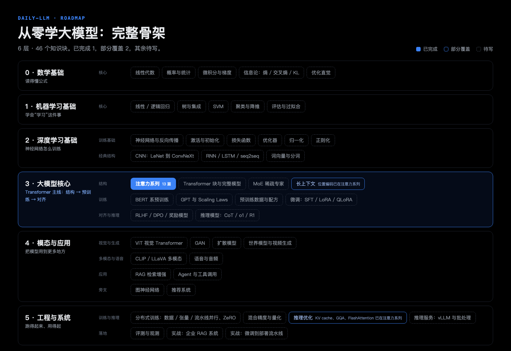

# 从零学大模型：完整骨架

> 由 [roadmap.json](roadmap.json) 生成（`node learn/build-roadmap.mjs`）。6 层、46 个知识块：已完成 1，部分覆盖 2，待写 43。
> “旧版素材”指 `_archive/v1/` 里可取材的旧内容（质量未重新核对，写新版时需重写）。

## 0 · 数学基础

读得懂公式

| 分组 | 知识块 | 状态 | 说明 / 旧版素材 |
|---|---|---|---|
| 核心 | 线性代数 | 待写 |  |
| 核心 | 概率与统计 | 待写 |  |
| 核心 | 微积分与梯度 | 待写 |  |
| 核心 | 信息论：熵 / 交叉熵 / KL | 待写 |  |
| 核心 | 优化直觉 | 待写 |  |

## 1 · 机器学习基础

学会“学习”这件事

| 分组 | 知识块 | 状态 | 说明 / 旧版素材 |
|---|---|---|---|
| 核心 | 线性 / 逻辑回归 | 待写 |  |
| 核心 | 树与集成 | 待写 |  |
| 核心 | SVM | 待写 |  |
| 核心 | 聚类与降维 | 待写 |  |
| 核心 | 评估与过拟合 | 待写 |  |

## 2 · 深度学习基础

神经网络怎么训练

| 分组 | 知识块 | 状态 | 说明 / 旧版素材 |
|---|---|---|---|
| 训练基础 | 神经网络与反向传播 | 待写 | `foundations/01` |
| 训练基础 | 激活与初始化 | 待写 | `foundations/02,05` |
| 训练基础 | 损失函数 | 待写 | `foundations/06` |
| 训练基础 | 优化器 | 待写 | `foundations/03` |
| 训练基础 | 归一化 | 待写 | `foundations/04` |
| 训练基础 | 正则化 | 待写 | `foundations/07` |
| 经典结构 | CNN：LeNet 到 ConvNeXt | 待写 | `01-cnn` |
| 经典结构 | RNN / LSTM / seq2seq | 待写 | `02-rnn-lstm` |
| 经典结构 | 词向量与分词 | 待写 | `03-word-embedding, foundations/09` |

## 3 · 大模型核心

Transformer 主线：结构 → 预训练 → 对齐

| 分组 | 知识块 | 状态 | 说明 / 旧版素材 |
|---|---|---|---|
| 结构 | [注意力系列](3-llm/01-attention/) | 已完成 | 13 篇 |
| 结构 | Transformer 块与完整模型 | 待写 | `05-transformer` |
| 结构 | MoE 稀疏专家 | 待写 | `13-moe-efficient` |
| 结构 | 长上下文 | 部分覆盖 | 位置编码已在注意力系列 |
| 训练 | BERT 系预训练 | 待写 | `06-bert-family` |
| 训练 | GPT 与 Scaling Laws | 待写 | `07-gpt-scaling` |
| 训练 | 预训练数据与配方 | 待写 |  |
| 训练 | 微调：SFT / LoRA / QLoRA | 待写 | `11-peft-lora` |
| 对齐与推理 | RLHF / DPO / 奖励模型 | 待写 | `12-rlhf-alignment` |
| 对齐与推理 | 推理模型：CoT / o1 / R1 | 待写 | `15-reasoning-o1-r1` |

## 4 · 模态与应用

把模型用到更多地方

| 分组 | 知识块 | 状态 | 说明 / 旧版素材 |
|---|---|---|---|
| 视觉与生成 | ViT 视觉 Transformer | 待写 | `08-vit` |
| 视觉与生成 | GAN | 待写 | `04-gan` |
| 视觉与生成 | 扩散模型 | 待写 | `10-diffusion` |
| 视觉与生成 | 世界模型与视频生成 | 待写 | `16-world-models` |
| 多模态与语音 | CLIP / LLaVA 多模态 | 待写 | `09-multimodal-clip` |
| 多模态与语音 | 语音与音频 | 待写 | `18-speech-audio` |
| 应用 | RAG 检索增强 | 待写 | `14-rag-agent` |
| 应用 | Agent 与工具调用 | 待写 | `14-rag-agent` |
| 旁支 | 图神经网络 | 待写 | `17-graph-neural-networks` |
| 旁支 | 推荐系统 | 待写 | `19-recommendation` |

## 5 · 工程与系统

跑得起来、用得起

| 分组 | 知识块 | 状态 | 说明 / 旧版素材 |
|---|---|---|---|
| 训练与推理 | 分布式训练：数据 / 张量 / 流水线并行、ZeRO | 待写 |  |
| 训练与推理 | 混合精度与量化 | 待写 |  |
| 训练与推理 | 推理优化 | 部分覆盖 | KV cache、GQA、FlashAttention 已在注意力系列 |
| 训练与推理 | 推理服务：vLLM 与批处理 | 待写 |  |
| 落地 | 评测与观测 | 待写 |  |
| 落地 | 实战：企业 RAG 系统 | 待写 | `projects/enterprise-rag-system` |
| 落地 | 实战：微调到部署流水线 | 待写 | `projects/finetune-deploy-pipeline` |
